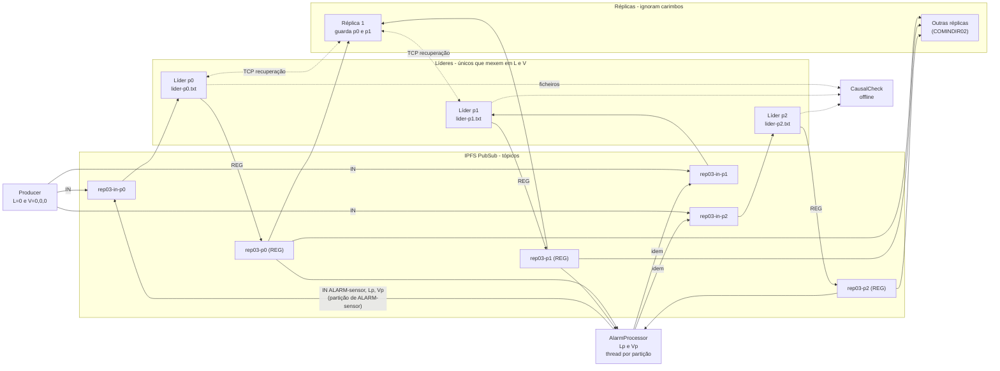
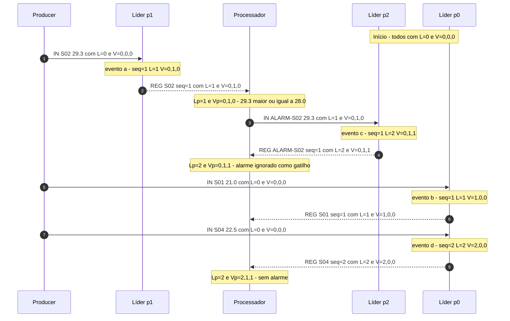
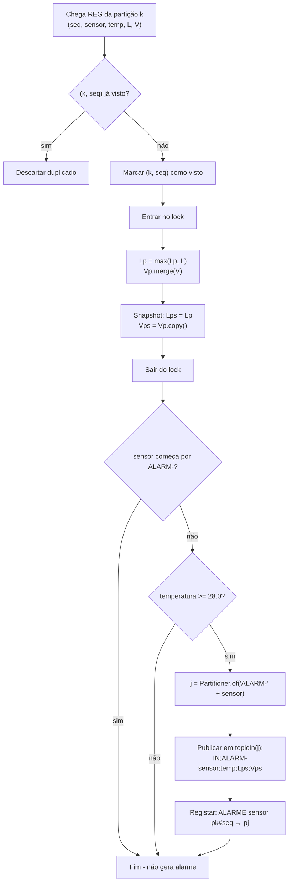
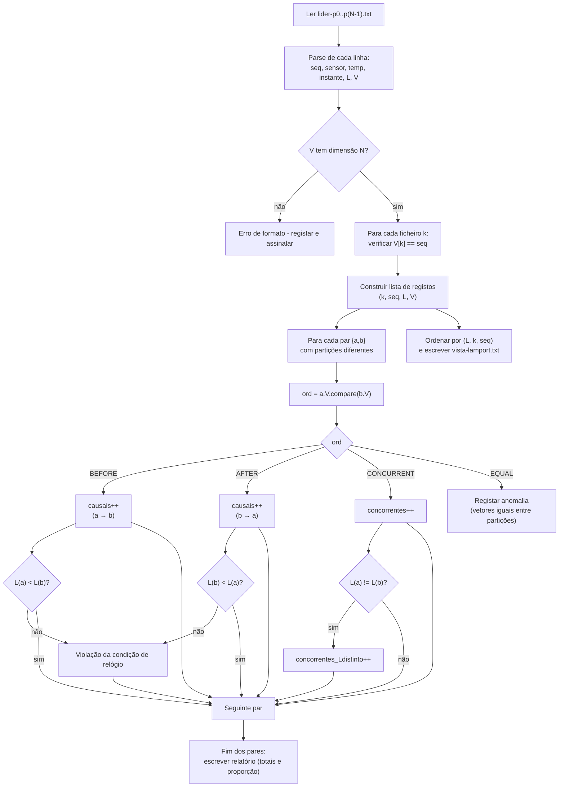

# COMINDIR03 · Relógios de Lamport e relógios vetoriais sobre partições

> Documento de estudo e guia de trabalho. Explica os conceitos, mostra um rastreio com valores, dá o desenho de cada classe e diz **o que medir e como raciocinar** nas experiências. Não contém as respostas finais das questões de análise nem números de ensaios: esses têm de vir das tuas execuções.
>
> Convenção: `k` = número da partição (0, 1, 2), `N = 3`, `L` = relógio de Lamport, `V` = relógio vetorial, `seq` = número de sequência da partição.

---

## 0. Pontos ambíguos do enunciado (a assinalar, não a assumir)

Reuni aqui tudo o que o enunciado deixa em aberto. Em cada ponto indico o que **eu** assumo neste documento; convém confirmares com o docente ou, no mínimo, declarares a tua escolha no relatório.

| # | Ambiguidade | O que assumo neste documento |
|---|---|---|
| A1 | **Função de partição.** A Figura 1 diz que `S01`, `S04` → p0, `S02` → p1 e `ALARM-S02` → p2, mas a função vem da COMINDIR02 e o código-fonte dessa ficha não está no repositório (só há `.class` em `out/`). | Uso a atribuição da Figura 1. Para os ensaios, descobre as partições com `Partitioner` real. |
| A2 | **O processador acumula `Vp` também com registos `ALARM-`?** O texto diz "atualiza com o máximo de *todos* os registos recebidos" e, noutro ponto, "ignora registos cujo sensor começa por `ALARM-`". | Os registos `ALARM-` entram no máximo (`Lp`/`Vp`), mas **não disparam** novo alarme. A alternativa (ignorar por completo) muda os carimbos de alarmes posteriores que caiam noutra partição. |
| A3 | **O que fazer se `V[k] != seq`?** O enunciado manda "verificar", mas não diz o que acontece (abortar? registar erro? descartar a mensagem?). | Registar erro, **não** fazer append e não publicar o REG. |
| A4 | **Pares: ordenados ou não ordenados?** "Classifica cada par ... como a→b, b→a ou concorrente" sugere contar `a→b` e `b→a` como classes separadas. | Pares **não ordenados** `{a,b}` de partições diferentes; um par causal conta uma vez, na classe "a→b" ou "b→a" conforme o sentido. |
| A5 | **Numeração dos ensaios.** A secção 4.3 fala em "ensaio 7(c)" e "ensaio 7(e)", mas os ensaios estão em 4.2. | Entendo 7(c) = 4.2(c) e 7(e) = 4.2(e). |
| A6 | **Que "instante" se compara no ensaio (e)?** O `instante` na linha do ficheiro pode ser o do líder (atribuição do seq) ou o da escrita na réplica. | Para detetar "escrito antes", o que interessa é a **posição da linha no ficheiro da réplica** (ordem de escrita); usa o `instante` apenas como apoio e diz qual é. |
| A7 | **Atribuição de réplicas.** Só sei que a réplica 1 guarda p0 e p1 (CA4). As outras vêm da COMINDIR02. | Não preciso do resto. |
| A8 | **Tamanho de "mensagem REG sem carimbos".** O REG tem endereço e porto, que não estão nos ficheiros. | Medir no próprio líder, no momento de publicar (secção 5.3). |
| A9 | **Leitor do ficheiro vazio no arranque** (`RecordFile.last()` devolve `null`). | `L = 0` e `V = (0,0,0)`. |
| A10 | O enunciado diz que o processador não gera eventos, mas ele **escreve** (publica IN). | Segue a definição do enunciado: evento = atribuição de `seq` por um líder. Publicar um IN não é um evento. |

Há ainda uma **correção de premissa** ao teu pedido: o `CausalCheck` lê os ficheiros `lider-p*.txt` e analisa relações causais entre registos. **Não** deteta por si só "um alarme escrito antes da leitura que o causou" numa réplica; isso é o ensaio (e), feito à mão sobre o ficheiro da réplica 1 (e podes, se quiseres, estender o teu código; ver 3.6).

---

## 1. Contexto: o que mudou em relação à COMINDIR02 e porquê

**COMINDIR02.** Cada partição `k` tem um líder que numera os registos (`seq`) e réplicas que os aplicam pela mesma ordem. Os líderes não falam entre si. Logo:

- dentro de uma partição há ordem total (o `seq`);
- entre partições **nunca há relação**: dois registos de partições distintas são sempre concorrentes. O `seq` de p0 e o `seq` de p2 são contadores independentes, e comparar `seq=5` de p0 com `seq=3` de p2 não diz nada.

**O que muda agora.** Aparece o **processador de alarmes**: lê registos de *todas* as partições e, quando vê uma temperatura ≥ 28,0 °C, escreve um registo derivado (`ALARM-<sensor>`), possivelmente noutra partição. Esse registo **depende causalmente** do que foi lido. Mas o `seq` não mostra essa dependência. É preciso um mecanismo novo.

| | COMINDIR02 | COMINDIR03 |
|---|---|---|
| Quem escreve | produtor | produtor + processador de alarmes |
| Dependências entre partições | nenhuma | criadas pelo processador |
| Carimbo de cada REG | `seq` | `seq`, `L` (Lamport), `V` (vetorial) |
| Ordem entre partições | nenhuma | causal com `V`; total (arbitrária) com `L` |

**O objetivo da ficha** não é impedir nada: é *medir* o que cada relógio consegue dizer. Daí que as réplicas **não** usem os carimbos (sem entrega causal) e que haja análise *a posteriori* sobre os ficheiros.

---

## 2. Arquitetura

### 2.1 Papel de cada componente

| Componente | Faz | Gera eventos? | Toca em `L`/`V`? |
|---|---|---|---|
| **Producer** | Gera leituras e publica `IN;sensor;temp;0;0,0,0` na partição certa. Nunca observou nada, logo envia relógio "vazio". | Não | Só envia zeros |
| **PartitionLeader (k)** | Subscreve `rep03-in-p<k>`. Para cada IN válido: atualiza `L` e `V`, atribui `seq`, escreve em `lider-p<k>.txt`, publica `REG` em `rep03-p<k>`. Responde ao pedido de recuperação por TCP. | **Sim** (cada atribuição de `seq`) | **Sim**, é o único que os atualiza |
| **PartitionReplica** | Subscreve `rep03-p<k>` das partições que guarda e aplica os registos pela regra da COMINDIR02 (por `seq` dentro de cada partição). Recupera por TCP. | Não | **Não** (guarda os carimbos, não os usa) |
| **AlarmProcessor** | Subscreve `rep03-p<k>` de *todas* as partições (uma thread por partição). Acumula `Lp`/`Vp`. Se temp ≥ 28,0 e sensor não é `ALARM-`, publica `IN;ALARM-<sensor>;temp;Lp;Vp` na partição de `ALARM-<sensor>`. | Não | Mantém `Lp`/`Vp`, **sem incrementar** |
| **CausalCheck** | Ferramenta offline: lê `lider-p*.txt` e escreve o relatório e `vista-lamport.txt`. | n/a | n/a |

Repara no papel do produtor e do processador: são **transportadores de conhecimento causal**. O produtor transporta "nada"; o processador transporta "tudo o que já vi".

### 2.2 Diagrama de arquitetura



O ciclo que cria a dependência entre partições é **REG → Processador → IN de outra partição**. Sem a seta do processador de volta para os tópicos `rep03-in-p<k>`, cada partição seria um mundo à parte.

Ordem de arranque (do enunciado): réplicas → líderes → processador → produtor. A lógica é "quem consome arranca antes de quem produz", para não perder mensagens de PubSub (que não são guardadas para quem ainda não subscreveu).

---

## 3. Conceitos

### 3.1 A relação "aconteceu antes" (→)

Lamport define `a → b` como a menor relação tal que:

1. **mesmo processo:** se `a` precede `b` no mesmo processo, `a → b`;
2. **mensagem:** se `a` é o envio e `b` a receção da mesma mensagem, `a → b`;
3. **transitividade:** `a → b` e `b → c` ⇒ `a → c`.

Se nem `a → b` nem `b → a`, são **concorrentes** (`a ∥ b`). Concorrente **não** significa "ao mesmo tempo". Significa "nenhum podia ter influenciado o outro".

**Nesta ficha**, os eventos são as atribuições de `seq` pelos líderes. As "mensagens" que criam arestas são a cadeia *REG → processador → IN → líder*. É por isso que `c` (alarme) depende de `a` (leitura), mas `b` (outra leitura que o processador ainda não viu) não.

### 3.2 Relógio de Lamport

**Estado:** um inteiro `L` por líder.

**Regra (única que esta ficha usa):** ao processar um IN com carimbo `Lmsg`:

```
L = max(L, Lmsg) + 1
```

A regra tem três casos clássicos; aqui colapsam numa só:

| Situação | Regra geral | Nesta ficha |
|---|---|---|
| Evento local | `L = L + 1` | Quando `Lmsg = 0` (produtor), dá `max(L,0)+1 = L+1` |
| Envio | `L = L + 1` e envia `L` | O líder não "envia" `L` por si; o REG publica o `L` já atribuído. O produtor/processador só retransmitem |
| Receção | `L = max(L, Lmsg) + 1` | Acontece quando o IN traz `Lmsg > L` (alarme) |

**Propriedade garantida (condição de relógio):**
```
a → b   ⇒   L(a) < L(b)
```
**Porquê:** ao longo de qualquer cadeia causal cada passo faz `L` subir pelo menos 1 (porque o `+1` está sempre lá e o `max` nunca desce).

**O que NÃO garante:** a implicação inversa. De `L(a) < L(b)` não se conclui `a → b`.

**Ordem total `(L, k)`:** ordenar por `L` e, em caso de empate, por `k`. É consistente com a causalidade (se `a → b` então `a` aparece antes de `b`), mas **ordena de forma arbitrária** os concorrentes. O critério de desempate (`k`) não tem significado causal.

> **Porque não deteta concorrência:** um único inteiro "esmaga" a história causal. Dois eventos concorrentes têm de receber *algum* número, e esse número é comparável com qualquer outro. Não há valor de `L` que signifique "não relacionado". Para detetar concorrência é preciso guardar *de quem* se sabe o quê, o que exige um vetor.

### 3.3 Relógio vetorial

**Estrutura:** vetor `V` de `N = 3` componentes, uma por **líder**. `V[i]` = "quantos eventos do líder `i` sei que aconteceram (e que influenciaram este)".

**Regra no líder `k`**, ao processar IN com `Vmsg`:
```
para cada i:  V[i] = max(V[i], Vmsg[i])     // merge
V[k] = V[k] + 1                              // tick
```
**Consequência importante:** só o líder `k` incrementa `V[k]`, logo, após cada evento, `V[k] == seq`. O vetor *generaliza* o `seq`: a componente `k` é o `seq`, as outras dizem o que se sabe das restantes partições.

**Comparação** (`compare` em `VectorClock`):

| Condição sobre todas as componentes | Resultado |
|---|---|
| `V(a)[i] ≤ V(b)[i]` para todo o `i`, e algum `<` | `a → b` (BEFORE) |
| `V(a)[i] ≥ V(b)[i]` para todo o `i`, e algum `>` | `b → a` (AFTER) |
| todas iguais | EQUAL (o mesmo evento / mesma informação) |
| algumas `<` e outras `>` | `a ∥ b` (CONCURRENT) |

**Porque caracteriza a causalidade (se e só se):**

- (⇒) se `a → b`, o conhecimento de `a` chegou a `b` através de merges que só aumentam; logo `V(a) ≤ V(b)`, e é estritamente menor porque `b` fez pelo menos um tick.
- (⇐) se `V(a) < V(b)`, então `V(b)[k_a] ≥ V(a)[k_a] = seq_a`. Como só o líder `k_a` cria valores em `k_a`, a única forma de `b` "conhecer" o evento `a` é existir uma cadeia de mensagens de `a` até `b`.

Se tens `V(a)[i] > V(b)[i]` e `V(b)[j] > V(a)[j]`, então cada um sabe de algo que o outro não sabe: nenhum pode ter precedido o outro ⇒ concorrentes.

**Porque `N` = número de partições** (pergunta de diagnóstico c): as componentes correspondem aos *processos cujos eventos se contam*, que são os líderes (os únicos que geram eventos). Réplicas e produtores não geram eventos, logo não têm componente. Pensa também no que aconteceria à relação `V[k] = seq` se houvesse componentes por réplica.

### 3.4 Porque o produtor envia `L = 0` e `V = [0,0,0]`

O produtor **não observa nenhum registo**: só gera leituras. Não tem conhecimento causal a transmitir, logo envia o elemento neutro do `max` (zeros).

O que acontece a seguir, no líder `k`:
```
L = max(L, 0) + 1 = L + 1
V = max(V, [0,0,0])  →  V (inalterado)
V[k] = V[k] + 1
```
Ou seja, para leituras do produtor, o líder limita-se a fazer tick. O resultado é `V = (0,..,seq,..,0)` **só se o líder nunca recebeu um IN com conhecimento de outras partições**. Quando um alarme lhe chega, `V` fica com outras componentes diferentes de zero *e permanece assim para sempre* (o merge só sobe). Isto significa que registos *posteriores* do mesmo líder, mesmo vindos do produtor com zeros, herdam esse conhecimento. É correto: em termos de processo, são posteriores ao evento do alarme.

### 3.5 O AlarmProcessor

**Estado:** `Lp` (long), `Vp` (VectorClock), conjunto de `(partição, seq)` já vistos. Partilhados pelas N threads, protegidos por um lock.

**Para cada REG recebido da partição `k`:**

1. descartar se `(k, seq)` já visto (duplicado);
2. sob lock: `Lp = max(Lp, L_reg)`; `Vp.merge(V_reg)`; copiar `Lp` e `Vp` (snapshot) para variáveis locais;
3. se sensor começa por `ALARM-`: não gera alarme (ver A2);
4. se `temperatura ≥ 28,0` (`Wire.LIMIAR_ALARME`): calcular `j = Partitioner.of("ALARM-" + sensor)` e publicar `IN;ALARM-<sensor>;<temp>;<Lp_snap>;<Vp_snap>` em `Wire.topicIn(j)`; registar `ALARME: <sensor> p<k>#<seq> → p<j>`.

**Nota:** o processador **não faz tick** em `Vp`/`Lp`: só `max`. Não é um processo com eventos nesta ficha (A10). O tick acontece no líder de destino.

**Herança da dependência causal.** O alarme transporta `Vp`, que inclui `V_reg` da leitura que o originou (passo 2 acontece *antes* de publicar). O líder `j` faz merge de `Vmsg = Vp` ⇒ `V(alarme) ≥ V(leitura)` com tick extra em `j` ⇒ `V(leitura) < V(alarme)` ⇒ `leitura → alarme`. Se o alarme caísse na *mesma* partição da leitura, a relação já era garantida pelo `seq`; o ganho do vetor é quando `j ≠ k`.

**Porque o máximo de *tudo* e não só da leitura que originou o alarme** (é a pergunta "Antes de avançar" do enunciado). Dá-te o raciocínio:

- Com o máximo de tudo, o alarme fica causalmente depois de **todos** os registos que o processador já tinha recebido no momento de publicar, incluindo leituras que não têm nada de especial (por exemplo `b`). Pergunta a ti: isso é "verdade" do ponto de vista do processo processador? (O processador *já tinha observado* `b` quando decidiu publicar.)
- Com a alternativa (só o `V_reg` da leitura), perdes essas relações. Para decidir se isso é bom ou mau, pergunta-te: *quais são as arestas de "aconteceu antes" reais num processo que recebe mensagens de vários sítios e depois envia uma?* (regra 1 + regra 2 + transitividade).

### 3.6 O CausalCheck

**Entrada:** pasta com `lider-p0.txt`, `lider-p1.txt`, `lider-p2.txt` (linhas `seq;sensor;temperatura;instante;L;V`).

**O que verifica / calcula:**

1. **`V[k] = seq`** em todas as linhas de cada ficheiro `lider-p<k>.txt`;
2. **classificação dos pares** de registos de partições diferentes: `a → b`, `b → a`, concorrente, com totais;
3. **condição de relógio:** para todo o par com `a → b` (segundo `V`), `L(a) < L(b)`; assinala violações;
4. **concorrentes com `L` distinto** e a proporção sobre o total de concorrentes;
5. **`vista-lamport.txt`:** todos os registos ordenados por `(L, k)` (e, para desempates dentro da partição, por `seq`).

**Que tipo de bugs apanha** (todos consequência de ler os ficheiros, que é onde os líderes escreveram o resultado final):

| Verificação | Apanha |
|---|---|
| `V[k] = seq` | Líder que perdeu ou duplicou eventos, reinício com `V` incorreto, vetor de dimensão errada, tick na componente errada |
| Condição de relógio | Líder que não faz `max` com `Lmsg`, reinício com `L` a zero |
| Contagem de pares causais | Sinal *indireto* de um merge omitido (por exemplo, "há ALARMEs no log mas zero pares causais") |

**O que NÃO apanha:** nada que não fique escrito nos ficheiros (leituras perdidas antes de chegarem ao líder, ordem de escrita nas réplicas, vetores partilhados por referência no processador se o texto serializado estiver correto).

**Extensão opcional (fora do pedido):** para o ensaio (e), basta um "mini-check" sobre o ficheiro de uma réplica: percorrer as linhas por ordem de escrita e, para cada par `(i < j)`, ver se `V(linha j) < V(linha i)` (isto é, a linha escrita depois *devia* ter vindo antes). Isto é, em essência, a violação de entrega causal que a ficha pede para observar à mão.

### 3.7 Persistência dos relógios e reinício do líder

Cada linha de `lider-p<k>.txt` guarda `L` e `V` **depois** do evento. Logo a **última linha** é o estado completo do líder.

No arranque: `RecordFile.last()` devolve o último registo (ou `null`); então
```
se last != null:  L = last.lamport;  V = last.vector.copy();  (seq = last.seq)
senão:            L = 0;  V = (0,0,0)
```
**Se o líder arrancasse a zero** (é uma das falhas a introduzir): os novos registos teriam `L` mais baixo do que registos anteriores da *mesma* partição (viola a condição de relógio *dentro* do processo), `V[k]` deixaria de coincidir com o `seq` (se o `seq` for retomado do ficheiro) e as componentes das outras partições "esquecidas" fariam registos novos parecer concorrentes com coisas de que deviam ser sucessores. Pensa também no que acontece se o `seq` *também* recomeçar a 1 (depende do que a tua COMINDIR02 faz; ver A1).

**Atenção:** `RecordFile.last()` deve ler a *última linha completa*. Se o líder morreu a meio de uma escrita, a última linha pode estar truncada; decide o que fazer (ignorar a incompleta e recuar uma linha).

---

## 4. Exemplo passo a passo com valores (Figura 1)

**Cenário (ensaio 4.2(a)):** o produtor envia, por esta ordem, `S02 29.3`, `S01 21.0`, `S04 22.5`. Partições (A1): `S01`, `S04` → p0; `S02` → p1; `ALARM-S02` → p2.

**Eventos nos líderes:**

| Evento | Registo | Partição |
|---|---|---|
| a | `S02 29.3` | p1 |
| c | `ALARM-S02 29.3` | p2 |
| b | `S01 21.0` | p0 |
| d | `S04 22.5` | p0 |

**Pressuposto de temporização (explícito):** o REG de `a` chega ao processador e este publica o alarme **antes** de ver `b`. Se o processador visse `b` antes de publicar, `c` herdava `b` (ver exercício no fim da secção).

### 4.1 Tabela de estado depois de cada passo

Notação: `L0,V0` = estado do líder p0, etc. `Lp,Vp` = processador. Os vetores escrevem-se `(v0,v1,v2)`.

| # | Passo | Líder p0 | Líder p1 | Líder p2 | Processador |
|---|---|---|---|---|---|
| 0 | Estado inicial | L=0, V=(0,0,0) | L=0, V=(0,0,0) | L=0, V=(0,0,0) | Lp=0, Vp=(0,0,0) |
| 1 | Produtor → p1: `IN;S02;29.3;0;0,0,0` | — | **evento a**: L=max(0,0)+1=**1**; merge → (0,0,0); tick V[1] → **(0,1,0)**; seq=1 | — | — |
| 2 | Processador recebe REG de a (`L=1`, `V=0,1,0`) | — | — | — | Lp=max(0,1)=**1**; Vp=max → **(0,1,0)**. 29.3 ≥ 28,0 ⇒ publica `IN;ALARM-S02;29.3;1;0,1,0` para p2 |
| 3 | Líder p2 recebe o alarme | — | — | **evento c**: L=max(0,1)+1=**2**; merge → (0,1,0); tick V[2] → **(0,1,1)**; seq=1 | — |
| 4 | Processador recebe REG de c (`L=2`, `V=0,1,1`) | — | — | — | Lp=**2**; Vp=**(0,1,1)** (A2). Sensor `ALARM-` ⇒ não gera alarme |
| 5 | Produtor → p0: `IN;S01;21.0;0;0,0,0` | **evento b**: L=max(0,0)+1=**1**; V=(0,0,0); tick V[0] → **(1,0,0)**; seq=1 | — | — | — |
| 6 | Produtor → p0: `IN;S04;22.5;0;0,0,0` | **evento d**: L=max(1,0)+1=**2**; tick V[0] → **(2,0,0)**; seq=2 | — | — | — |
| 7 | Processador recebe REGs de b e d | — | — | — | Após b: Lp=2, Vp=(1,1,1). Após d: Lp=2, Vp=**(2,1,1)**. 21,0 e 22,5 < 28,0 ⇒ nada |

**Carimbos finais atribuídos pelos líderes** (batem com a Figura 1):

| Evento | seq | L | V |
|---|---:|---:|---|
| a (p1) | 1 | 1 | (0,1,0) |
| c (p2) | 1 | 2 | (0,1,1) |
| b (p0) | 1 | 1 | (1,0,0) |
| d (p0) | 2 | 2 | (2,0,0) |

Confirma em cada linha que `V[k] = seq` (a: V[1]=1 ✓; c: V[2]=1 ✓; b: V[0]=1 ✓; d: V[0]=2 ✓).

### 4.2 Comparação de pares

| Par | Vetores | Resultado vetorial | L | Ordem `(L,k)` | Comentário |
|---|---|---|---|---|---|
| **a, c** | (0,1,0) vs (0,1,1): todas `≤`, a última `<` | **a → c** | 1 < 2 | a antes de c | Relação causal: o alarme veio da leitura a. Lamport e V concordam |
| **b, d** | (1,0,0) vs (2,0,0) | **b → d** | 1 < 2 | b antes de d | Mesma partição (já garantido pelo seq) |
| **b, c** | (1,0,0) vs (0,1,1): comp. 0 `1>0`, comp. 1 `0<1` | **b ∥ c** | 1 < 2 | b antes de c | **Caso que mostra a limitação de Lamport:** `L(b) < L(c)` mas são concorrentes |
| **c, d** | (0,1,1) vs (2,0,0): comp. 0 `0<2`, comp. 1 `1>0` | **c ∥ d** | 2 = 2 | d antes de c | Empate em L, desempatado por `k` (0 < 2), sem significado causal |
| a, b | (0,1,0) vs (1,0,0) | a ∥ b | 1 = 1 | b antes de a | Empate; desempate por `k` |
| a, d | (0,1,0) vs (2,0,0) | a ∥ d | 1 < 2 | a antes de d | L distinto mas concorrentes |

**Pares entre partições diferentes** neste exemplo (b e d estão ambos em p0, logo `(b,d)` não conta): `(a,b)`, `(a,d)`, `(a,c)`, `(b,c)`, `(c,d)`. São 5, dos quais **1 causal** (`a→c`) e **4 concorrentes**; dos 4 concorrentes, **2** têm `L` distinto (`(a,d)` e `(b,c)`).

**Vista de Lamport** `(L,k)`: `b(1,0)`, `a(1,1)`, `d(2,0)`, `c(2,2)`. Repara que `a` está antes de `c` (correto) mas `b` aparece antes de `a`, e `d` antes de `c`, sem relação causal nenhuma.

### 4.3 Exercícios sobre este exemplo (para responderes tu)

1. Refaz a tabela **com a variante** em que o processador já tinha recebido o REG de `b` antes de publicar o alarme. Que `L` e `V` tem agora `c`? Que par muda de classe?
2. Imagina agora que depois de `c` chega `S02 30.1` (outro alarme). Que `V` terá o segundo alarme, em função de A2 (merge ou não dos registos `ALARM-`)?
3. Se o produtor enviasse depois `S01 22.0` para p0, que `V` e `L` teria, e como se relaciona com `c`? (Pensa: o produtor envia zeros.)

---

## 5. Diagramas de sequência e fluxogramas

### 5.1 Diagrama espaço-tempo do exemplo



As setas cheias são mensagens IN (produtor ou processador → líder); as tracejadas são REG (líder → processador, que as réplicas também recebem). Repara que a seta `PR → L2` é a **única** que liga duas partições.

### 5.2 Fluxograma do AlarmProcessor (por registo recebido)



### 5.3 Fluxograma do CausalCheck



---

## 6. Guia de implementação (orientação)

### 6.1 Ordem recomendada

1. **Preparar os projetos.** Copiar COMINDIR02 → `rep03-produtor`, `rep03-lider`, `rep03-replica`; criar `rep03-processador`. Renomear pacote para `rep03` e prefixo de tópicos para `rep03`. Compilar tudo *antes* de mexer em lógica. É o passo mais aborrecido e o que mais confusão causa se falhar.
2. **`VectorClock`** nos quatro projetos (o código vem no enunciado; copia-o tal e qual). Escreve um mini-teste com os valores da secção 4 (merge, tick, compare, parse/toString com dimensão errada).
3. **`SensorRecord`**: campos `lamport` e `vector`, `toLine`/`fromLine` com o formato `seq;sensor;temp;instante;L;V`. Atenção: o `V` usa vírgulas e o separador do ficheiro é `;`, por isso não há conflito, mas valida o número de campos.
4. **`Wire`**: `in(...)` e `reg(...)` com `L;V`; constante `LIMIAR_ALARME = 28.0`; parsers correspondentes. Mensagens com nº de campos errado devem ser rejeitadas, não crashar.
5. **`Producer`**: enviar sempre `0` e `new VectorClock(N)`.
6. **`RecordFile.last()`** e **`PartitionLeader`** com a secção sincronizada. Testa só com o produtor (sem processador): `V` deve ter só a componente `k` não nula.
7. **`AlarmProcessor`.** Primeiro só ler e imprimir; depois acumular `Lp`/`Vp`; só no fim publicar alarmes.
8. **`CausalCheck`.** Começa por V[k]=seq; depois classificação dos pares; depois a condição de relógio; por fim `vista-lamport.txt`.
9. **Ensaios** pela ordem do enunciado; só então as falhas deliberadas (uma de cada vez, repondo o código).

### 6.2 `VectorClock`

*Já dado pelo enunciado.* Questões que deves saber responder:

- **Monitor:** a classe não é sincronizada. O líder deve usar *o mesmo objeto* de lock que protege `seq` e o `append` (um `final Object lock` ou `this`). O que importa é que seja um só e que o `L`, o `V`, o `seq` e o ficheiro estejam todos protegidos por ele.
- **`copy()`:** o líder (e o processador) alteram o vetor *in place* (`merge`, `tick`). Se o `SensorRecord`/mensagem guardasse a *referência*, o REG publicado depois do lock refletiria estado posterior, possivelmente de outro evento. A cópia fixa o valor no instante do evento.

### 6.3 `SensorRecord` e `Wire`

- Responsabilidade: (de)serialização. Nada de lógica de relógios.
- Atributos novos: `long lamport`, `VectorClock vector`.
- Cuidado com o `fromLine` aceitar também linhas antigas (sem L/V)? **Não**: o enunciado define um só formato; decide e documenta (rejeitar é mais seguro).
- Em `Wire`, uma função de parsing do IN e do REG que devolva uma pequena estrutura. Deixar o `VectorClock.parse(s, N)` lançar `IllegalArgumentException` e **apanhar** essa exceção no consumidor (para o caso N≠3).

### 6.4 `PartitionLeader`: o coração

**Responsabilidade:** converter um IN em evento (relógios + seq + escrita) e publicar o REG.

**Atributos novos:** `long L`, `VectorClock V` (dimensão N), o objeto de lock (já existente se a COMINDIR02 já sincroniza o seq).

**Pseudocódigo (tratamento de um IN):**
```
onIn(msg):
    try  in = Wire.parseIn(msg, N)        // sensor, temp, Lmsg, Vmsg
    catch (formato ou dimensão inválidos) { log e descartar; return }

    synchronized (lock):
        L = max(L, in.L) + 1                     // Lamport
        V.merge(in.V);  V.tick(k)                // vetorial
        seq = seq + 1
        se V.get(k) != seq:                      // A3
            log ERRO; (reverter ou abortar conforme decidires); return
        rec = new SensorRecord(seq, sensor, temp, agora(), L, V.copy())
        file.append(rec)
    log "EVENTO: seq=<seq> L=<L> V=<V>"          // usar os valores do rec, não os campos
    publicar REG(endereço, porto, rec)
```
Pontos a pensar:

- **Porque tudo na mesma secção:** se atualizares `L`/`V` e atribuíres `seq` em secções diferentes, duas threads podem intercalar-se e dar a dois registos o mesmo `seq`, ou escrever no ficheiro `seq=5` antes do `seq=4`, ou `V[k] != seq`. Pensa que erro verias no `lider-p<k>.txt` e na verificação de `V[k]==seq`.
- **Log do EVENTO:** imprime os valores guardados no `rec`, não os campos partilhados lidos depois do lock (já podem ter sido alterados por outra thread).
- **Publicar fora do lock:** não faz IO de rede dentro da secção crítica. Consequência: dois REG da mesma partição podem ser publicados fora de ordem; a COMINDIR02 já lida com isso nas réplicas (reordenação por `seq`). Confirma na tua versão.
- **Arranque:** `last = RecordFile.last(); se last != null: L = last.lamport; V = last.vector.copy(); (seq vem do último registo)`.

### 6.5 `AlarmProcessor`

**Responsabilidade:** observar todas as partições, acumular conhecimento causal, derivar alarmes.

**Atributos:** `int N`; `long Lp`; `VectorClock Vp`; `Set<String> vistos` (`"k#seq"`); `Object lock`; cliente IPFS (`IpfsPubSub`, `api` opcional).

**Pseudocódigo:**
```
main(args): N = args[0]; api = args[1] se existir
    Lp = 0; Vp = new VectorClock(N)
    para k em 0..N-1:  nova Thread(() -> subscrever(Wire.topicData(k), reg -> onReg(k, reg))).start()

onReg(k, raw):
    reg = Wire.parseReg(raw, N)                  // rejeita dimensão errada
    snapshotL, snapshotV;
    synchronized (lock):
        se !vistos.add(k + "#" + reg.seq): return    // duplicado
        Lp = max(Lp, reg.L);  Vp.merge(reg.V)
        snapshotL = Lp;  snapshotV = Vp.copy()       // <- copy() dentro do lock
    se reg.sensor.startsWith("ALARM-"): return
    se reg.temp >= Wire.LIMIAR_ALARME:
        j = Partitioner.of("ALARM-" + reg.sensor)    // usar a mesma função da COMINDIR02
        publicar(Wire.topicIn(j), Wire.in("ALARM-"+reg.sensor, reg.temp, snapshotL, snapshotV))
        log "ALARME: <sensor> p<k>#<seq> → p<j>"
```
Restrições a respeitar: sem bibliotecas externas; vetor de dimensão fixa `N` (argumento); os alarmes não geram alarmes.

### 6.6 `CausalCheck`

**Responsabilidade:** análise offline. Corre sem rede.

**Pseudocódigo:**
```
main(args): N = args[0]; pasta = args[1]
    para k em 0..N-1:  regs[k] = lerFicheiro(pasta/lider-p{k}.txt)   // [] se não existir
    erros = 0
    para k: para cada r em regs[k]:  se r.V.get(k) != r.seq:  assinalar(k, r); erros++

    causais = 0; concorrentes = 0; concorrentesLdistinto = 0; violacoes = 0
    para (i, j) com i < j:                     // pares de partições
        para a em regs[i]: para b em regs[j]:
            ord = a.V.compare(b.V)
            BEFORE:     causais++;  se !(a.L < b.L): violacoes++
            AFTER:      causais++;  se !(b.L < a.L): violacoes++
            CONCURRENT: concorrentes++;  se a.L != b.L: concorrentesLdistinto++
            EQUAL:      assinalar anomalia
    proporcao = concorrentes == 0 ? n/a : concorrentesLdistinto / concorrentes
    todos = união ordenada por (L, k, seq); escrever vista-lamport.txt
    imprimir relatório
```
Notas:

- **Complexidade:** `O(n²)` no total de registos; com poucas centenas de registos é trivial.
- **EQUAL** entre partições diferentes não deveria acontecer (cada evento faz tick na sua componente). Se acontecer, é um sinal de bug; reporta-o em vez de o esconder.
- O `compare` assume mesma dimensão; garante-o no parse.

---

## 7. Experiências e análise

### 7.1 Ensaios (4.2)

| Ensaio | O que fazer | O que observar | Como interpretar |
|---|---|---|---|
| **(a)** Reproduzir a Figura 1 | Arrancar tudo na ordem (réplicas, líderes, processador, produtor). Introduzir **por esta ordem e com intervalo suficiente** `S02 29.3`, `S01 21.0`, `S04 22.5`. Correr `CausalCheck`. | Nos ficheiros e nos logs `EVENTO:`: `seq/L/V` de a, b, c, d. Que `ALARME: S02 p1#1 → p2` aparece. | Devem bater com a tabela da secção 4. Se `c` vier com `V=(1,1,1)`, o processador viu `b` antes de publicar (problema de temporização, não de código). |
| **(b)** Rajada sem processador | Processador parado; `rajada 300 10`; `CausalCheck`. | Nº de pares causais entre partições. | Pensa em que operação cria entradas não nulas em componentes ≠ `k` de um `V`. Sem processador, que vetores existem? Compara dois vetores `(0,..,s,..,0)` de partições diferentes. |
| **(c)** Rajada com processador, 3 vezes | Processador ativo; `rajada 300 10` três vezes (limpa os ficheiros entre execuções, ou usa pastas distintas). | Por execução: nº de alarmes, pares causais, pares concorrentes, concorrentes com `L` distinto. | Compara execuções: o que varia (leituras aleatórias → nº de alarmes diferente) e o que isso faz às contagens. |
| **(d)** Reiniciar o líder p2 | Parar p2; voltar a arrancar; enviar leituras para p2. | Linhas `EVENTO:` pós-reinício: `L` e `V` continuam dos valores finais anteriores? | `V[2]` e `seq` devem prosseguir; as outras componentes não regridem. Confirma com `CausalCheck` que não há violações. |
| **(e)** Alarme antes da causa na réplica 1 | Escolher sensores cujo alarme caia em p0 ou p1 e cuja leitura caia na outra (ou na mesma) das partições da réplica 1. Rajada com atrasos/desordem. Inspecionar o ficheiro da réplica 1. | Posição das linhas: procura uma linha `ALARM-X` **antes** da linha de `X`. Compara o `instante` (A6). | A réplica aplica por `seq` dentro de cada partição e entre partições não tem regra. Logo isto *pode* acontecer. Se não aparecer, não prova que não possa; é uma questão de temporização. |

**Dica para (e):** usa o teu `Partitioner` num `main` auxiliar para encontrar nomes de sensor `X` tais que `Partitioner.of(X)` e `Partitioner.of("ALARM-"+X)` estejam em {p0, p1} e sejam diferentes.

### 7.2 Falhas deliberadas

Para cada uma: introduz o erro, corre o mesmo ensaio (sugiro uma rajada com alarmes), regista **onde** se manifestou (líder? processador? análise?), **se** o `CausalCheck` apanhou, e a conclusão. A coluna "hipótese" é o que eu *espero* com base no raciocínio; **tens de verificar** e escrever o que realmente observaste.

| Falha | Hipótese a testar (não é resultado) | Como decidir "detetada" |
|---|---|---|
| **Líder faz `tick` sem `merge`** | `V[k] = seq` continua a valer, logo o teste 1 passa. Os alarmes deixam de herdar conhecimento ⇒ desaparecem (ou quase) os pares causais entre partições. A condição de relógio é vácua. | Tens `ALARME:` no log mas zero (ou muito menos) pares causais ⇒ deteção **indireta**. Se só olhas para as violações explícitas, escapa. |
| **Líder atualiza `L` sem ter em conta `Lmsg`** | Um alarme pode receber `L` menor ou igual ao da leitura que o causou ⇒ violação da condição de relógio. Só se manifesta se `L` do líder de destino for inferior. | Verificação 3 do CausalCheck (violações). Pode ser intermitente; repete o ensaio. |
| **Líder reiniciado com `L` e `V` a zero** | Registos novos com `L` baixo (violação *dentro* da partição) e `V[k] != seq` se o `seq` for retomado do ficheiro. | Verificação 1 e 3. Compara os dois casos (seq retomado versus seq reiniciado). |
| **Processador publica o vetor sem `copy()`** | Só há efeito se a serialização acontecer **fora** do lock e outra thread alterar `Vp` entretanto. Se serializares a `String` dentro do lock, o bug pode nem se manifestar: diz isso. Se se manifestar, o alarme leva conhecimento a mais ⇒ falsas relações causais. | `V[k]=seq` e a condição de relógio continuam OK ⇒ provavelmente **não detetado** (falso positivo de causalidade não deixa rasto). Explica porquê. |
| **Produtor com N=4, resto com N=3** | O `Partitioner` do produtor muda com `N`, enviando IN para `rep03-in-p3` (sem líder) e vetores de dimensão 4 aos restantes líderes. Estes devem rejeitar o IN (exceção de dimensão apanhada) e nada é escrito. | `CausalCheck` só vê o que ficou escrito (menos registos, nenhum vetor errado). O defeito manifesta-se **no líder** (log de rejeição). Se correres `CausalCheck 4` sobre ficheiros N=3, é a validação de dimensão que o deteta. |

### 7.3 Como preencher cada métrica da tabela 4.3

Todos os valores são a **média das três execuções** do ensaio (c). Não inventes: tudo sai dos ficheiros e logs.

| Métrica | O que contar | Onde obter |
|---|---|---|
| Registos por partição (p0/p1/p2) | Nº de linhas de cada `lider-p<k>.txt` (por execução e depois a média) | `wc -l` ou o próprio `CausalCheck` |
| Alarmes publicados | Nº de linhas `ALARME:` no log do processador **e** nº de registos com sensor `ALARM-` nos ficheiros. Devem coincidir; se não, houve perda ou rejeição | log do processador; ficheiros dos líderes |
| Pares causais entre partições | Total de pares com `a→b` ou `b→a` (ver A4) | relatório do `CausalCheck` |
| Pares concorrentes entre partições | Total de pares concorrentes | relatório do `CausalCheck` |
| Pares concorrentes com `L` distinto (proporção) | `concorrentesLdistinto / concorrentes` | relatório do `CausalCheck` |
| Tamanho médio de REG **sem** carimbos | Média, em bytes UTF-8, do REG com o formato da COMINDIR02 (`REG;endereço;porto;seq;sensor;temp;instante`) | Medir **no líder**, ao publicar: `msg.getBytes(UTF_8).length`; somar e dividir pelo nº de REG |
| Tamanho médio de REG **com** carimbos | Idem, com `;L;V` no fim | Mesmo sítio, mesma contagem |

**Como medir os dois tamanhos sem enganos:** construir as duas strings (com e sem `;L;V`) a partir do **mesmo** registo, para comparar maçãs com maçãs, acumular dois contadores e escrever a média no fim (ou a cada N mensagens). A diferença é exatamente o custo dos carimbos. Compara-a com o tamanho total: o endereço do nó IPFS é longo, por isso o custo *relativo* pode ser pequeno mesmo que o absoluto não o seja (lê o valor medido, não o assumas).

**Sanity checks antes de escrever a tabela:**

- `causais + concorrentes` deve ser igual ao total de pares entre partições `= n0·n1 + n0·n2 + n1·n2`.
- As três execuções têm contagens diferentes de alarmes; é normal.

### 7.4 Perguntas de análise: conceitos e raciocínio

Não escrevo as respostas; dou-te as peças.

**1. Lamport e concorrência.**
- Conceito: condição de relógio (⇒ só num sentido) e ordem `(L,k)`.
- Raciocínio: um par concorrente com `L` distinto é *ordenado* por Lamport apesar de não haver relação. A tua proporção mede quantos pares concorrentes "parecem" ordenados.
- Para a consequência de usar `vista-lamport.txt` para afirmar "o alarme foi provocado por esta leitura": pensa no par `(b, c)` do enunciado. Se na vista a leitura `b` aparece antes do alarme `c`, podes concluir que `b` o causou? E o que tens de consultar em alternativa?

**2. Dimensão do vetor.**
- Conceito: custo = `N` componentes por mensagem. Calcula o custo medido (bytes) para `N=3` e pensa na função de `N` (cada componente é um inteiro em texto, mais separadores).
- Raciocínio para N variável: que significa um vetor de dimensão 3 quando passas a ter 4 líderes? Como comparas `(1,2,3)` com `(1,2,3,0)`? E os ficheiros já escritos?

**3. Relógios e números de sequência.**
- Conceito: `V[k] = seq`.
- Raciocínio: o `seq` está dentro do vetor, logo "redundante" em informação. Pergunta a ti: *o que é que o `seq` oferece que o vetor não oferece de forma direta*? Pensa em como as réplicas e a recuperação TCP usam o `seq` (aplicação em ordem, deteção de buracos por partição) e se alguma delas precisa do resto do vetor.

**4. Entrega causal.**
- Conceito: uma réplica "entrega" (escreve) um registo quando todas as suas dependências já foram escritas. Com vetores: o registo `r` da partição `j` só pode ser escrito se, para cada partição `i ≠ j`, a réplica já tiver aplicado pelo menos até `V(r)[i]`, e se `r` for o próximo em `j`.
- Raciocínio sobre "só sobre as partições que a réplica guarda": a réplica só sabe o seu progresso nas partições que recebe. Que valor usaria para a partição que não guarda? Consegue esperar por algo que nunca vai receber?
- Âmbito: relê a secção 2.1 do enunciado (limite explícito) e o que lá se diz sobre retenção de registos.

**5. Troço produtor → líder.**
- Conceito: o que cada relógio mede (eventos *dos líderes*, a contagem começa nos líderes).
- Raciocínio: o produtor envia sempre `L=0` e `V=0`. Uma leitura perdida nunca chegou a ser um evento. Pergunta: que mudança observável provoca no `seq`, em `L` e em `V` a ausência de um evento que nunca existiu? E, ao contrário, o que veríamos se o *líder* perdesse um registo já numerado?

### 7.5 Perguntas de verificação por critério (guião para a oral)

| CA | Onde ir buscar a resposta |
|---|---|
| **CA1** Concorrentes com c; porque `(L,k)` é consistente; vetor de `c` se o processador tivesse visto `b` | Secção 4.2 e exercício 4.3.1; secção 3.2 |
| **CA2** Onde se atualiza L/V, onde o processador acumula, onde se serializa; sincronização; reinício; réplicas | Secções 6.4, 6.5, 3.7, 2.1 |
| **CA3** Pares causais numa rajada sem alarmes; fração de concorrentes com `L` distinto; processador parado | Ensaios (b) e (c); secção 3.3 e 7.1. Pensa: sem alarmes, quem cria componentes ≠ `k` em `V`? |
| **CA4** Limitações: dimensão fixa, perdas, ausência de entrega causal | Secção 7.4 (pontos 2, 4, 5) |

---

## 8. Resumo de uma página: conceitos-chave

- **Problema.** Quando um processo (o processador) lê numa partição e escreve noutra, o `seq` por partição deixa de bastar: escondem-se dependências causais.
- **Eventos** = atribuições de `seq` pelos líderes. Produtor e processador **só transportam** conhecimento.
- **Lamport (`L`)**: `L = max(L, Lmsg) + 1`. Garante `a → b ⇒ L(a) < L(b)`. **Não** garante o inverso. Dá uma ordem total `(L, k)` consistente com a causalidade mas arbitrária entre concorrentes.
- **Vetorial (`V`, N=3)**: `V = max(V, Vmsg)` componente a componente e `V[k]++`. Caracteriza: `a → b ⇔ V(a) < V(b)`; concorrentes ⇔ incomparáveis. Em cada evento, `V[k] = seq`.
- **Produtor** envia `L=0, V=(0,0,0)`: não observa nada. Sem processador, os vetores têm só a componente `k` ⇒ todos os pares entre partições são concorrentes.
- **Processador** acumula o máximo de **tudo** o que recebe (`Lp`, `Vp`) e carrega-o nos alarmes `ALARM-<sensor>`; o alarme fica causalmente depois de tudo o que o processador tinha visto. Não gera alarmes sobre alarmes; ignora duplicados.
- **Líder**: numa só secção sincronizada atualiza `L`, `V`, atribui `seq`, verifica `V[k]==seq`, faz append; só depois publica o REG com cópia do vetor. No reinício retoma `L`/`V` da última linha do seu ficheiro.
- **Réplicas** ignoram os carimbos ⇒ podem escrever um alarme antes da causa. Resolver exigiria **entrega causal** (fora do âmbito).
- **CausalCheck** verifica `V[k]=seq`, classifica pares (causal/concorrente), verifica a condição de relógio, mede a fração de concorrentes ordenados por Lamport e gera `vista-lamport.txt`.
- **Limitações que se mantêm:** `N` fixo (mudar `N` invalida vetores antigos); leituras perdidas antes do líder não deixam rasto; sem entrega causal; `(L,k)` não identifica causas.

### Glossário

| Termo | Significado |
|---|---|
| **Evento** | Atribuição de um `seq` por um líder |
| **Aconteceu antes (→)** | Relação de Lamport: ordem por processo, por mensagem, e transitiva |
| **Concorrentes (∥)** | Nem `a → b` nem `b → a` |
| **Relógio de Lamport (L)** | Contador inteiro com `max+1`; ordem consistente, não caracteriza causalidade |
| **Relógio vetorial (V)** | Vetor com uma componente por líder; caracteriza causalidade |
| **Condição de relógio** | `a → b ⇒ L(a) < L(b)` |
| **Ordem total `(L,k)`** | Ordenar por `L`, desempate por `k`; arbitrária entre concorrentes |
| **Merge** | Máximo componente a componente |
| **Tick** | Incremento da própria componente `V[k]` |
| **Carimbo** | O par `(L, V)` que acompanha as mensagens |
| **IN / REG** | Mensagem produtor/processador → líder / mensagem líder → réplicas e processador |
| **Entrega causal** | Reter um registo até que as suas dependências estejam aplicadas (fora do âmbito) |
| **Alarme derivado** | Registo `ALARM-<sensor>` publicado pelo processador quando `temp ≥ 28,0` |
| **`LIMIAR_ALARME`** | Constante em `Wire`, 28,0 |
| **Snapshot / `copy()`** | Cópia do vetor num instante, para não ser alterado por outra thread |
