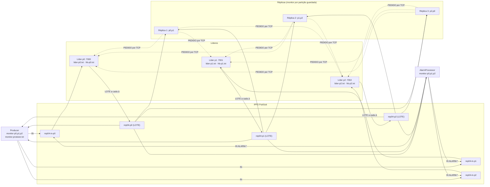
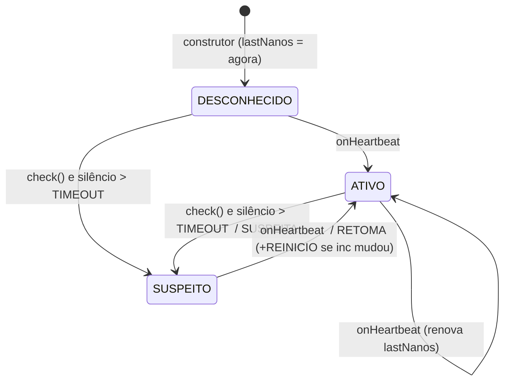

# COMINDIR04 · Deteção de falhas do líder por heartbeat e envio em lote

Relatório de estudo e guião para a apresentação oral. Explica **o que é**, **como funciona cada peça**, **o fluxo completo**, **onde está cada coisa no código** (com ligações para as linhas), os **casos de uso**, e as **perguntas prováveis com resposta**.

> Ficha: <https://github.com/cunhaestgv/SD-2026-2027/issues/17> · Base: COMINDIR03 (relógios de Lamport e vetoriais).

---

## Índice

0. [Entregáveis e como compilar](#0-entregáveis-e-como-compilar)
1. [Pontos ambíguos e decisões tomadas](#1-pontos-ambíguos-e-decisões-tomadas)
2. [O que é, em poucas palavras](#2-o-que-é-em-poucas-palavras)
3. [Conceitos](#3-conceitos)
4. [Arquitetura](#4-arquitetura)
5. [Formatos de mensagens e ficheiros (com exemplos reais)](#5-formatos-de-mensagens-e-ficheiros-com-exemplos-reais)
6. [Fluxo completo, passo a passo](#6-fluxo-completo-passo-a-passo)
7. [Mapa do código: onde está cada coisa](#7-mapa-do-código-onde-está-cada-coisa)
8. [Concorrência e sincronização](#8-concorrência-e-sincronização)
9. [Casos de uso / cenários](#9-casos-de-uso--cenários)
10. [Como executar os ensaios (Windows e Linux)](#10-como-executar-os-ensaios-windows-e-linux)
11. [Validação feita (IPFS simulado)](#11-validação-feita-ipfs-simulado)
12. [Falhas deliberadas (secção 9 da ficha)](#12-falhas-deliberadas-secção-9-da-ficha)
13. [Respostas às perguntas da ficha](#13-respostas-às-perguntas-da-ficha)
14. [Perguntas prováveis na apresentação (rápidas)](#14-perguntas-prováveis-na-apresentação-rápidas)
15. [Limitações que se mantêm](#15-limitações-que-se-mantêm)
16. [Resumo de uma página e glossário](#16-resumo-de-uma-página-e-glossário)

---

## 0. Entregáveis e como compilar

Quatro projetos, todos no pacote `rep04`, copiados da COMINDIR03 com o prefixo dos tópicos mudado para `rep04`:

| Projeto | Classes | Classe principal |
|---|---|---|
| [rep04-lider/](rep04-lider/) | `PartitionLeader`, `Batch`, `HeartbeatMonitor`, `Wire`, `SensorRecord`, `RecordFile`, `VectorClock`, `Partitioner`, `IpfsPubSub` | `rep04.PartitionLeader <k> <N> [endereço] [api]` |
| [rep04-replica/](rep04-replica/) | `PartitionReplica`, **`HeartbeatCheck`**, `CausalCheck`, `Batch`, `HeartbeatMonitor` + partilhadas | `rep04.PartitionReplica <id> <partições> [portoApi]` |
| [rep04-processador/](rep04-processador/) | `AlarmProcessor`, `Batch`, `HeartbeatMonitor` + partilhadas | `rep04.AlarmProcessor <N> [api]` |
| [rep04-produtor/](rep04-produtor/) | `Producer`, `Batch`, `HeartbeatMonitor` + partilhadas | `rep04.Producer <N> [api]` |

As classes partilhadas (`Wire`, `Batch`, `HeartbeatMonitor`, `SensorRecord`, `IpfsPubSub`, `VectorClock`, `Partitioner`) são **iguais byte a byte** nos quatro projetos. Se alterares uma, copia-a para os outros.

**Compilar** (em cada projeto; já estão compiladas em `out/`):

```bash
cd rep04-lider && javac -encoding UTF-8 -d out src/rep04/*.java
```

**O que é novo ou mudou, por ficheiro:**

| Ficheiro | Estado | Resumo |
|---|---|---|
| [HeartbeatMonitor.java](rep04-lider/src/rep04/HeartbeatMonitor.java) | **novo** (código dado na ficha) | Detetor de falhas de uma partição: `DESCONHECIDO → ATIVO ↔ SUSPEITO` |
| [Batch.java](rep04-lider/src/rep04/Batch.java) | **novo** | Mensagem `LOTE`: `encode()`, `decode()`, `header()` |
| [HeartbeatCheck.java](rep04-replica/src/rep04/HeartbeatCheck.java) | **novo** | Análise a posteriori dos ficheiros `hb-`, `lider-` e `monitor-` |
| [Wire.java](rep04-lider/src/rep04/Wire.java) | alterado | Sai `reg(...)`/`regParts(...)`; entram `PERIODO_HB_MS`, `FATOR_TIMEOUT`, `VERIFICACAO_MS` |
| [PartitionLeader.java](rep04-lider/src/rep04/PartitionLeader.java) | alterado | `inc`, `hb`, `pendentes`, `enviarLote()` periódico, `hb-p<k>.txt` |
| [PartitionReplica.java](rep04-replica/src/rep04/PartitionReplica.java) | alterado | Recebe `LOTE`, monitor por partição, recuperação pelo `ultimoSeq` |
| [AlarmProcessor.java](rep04-processador/src/rep04/AlarmProcessor.java) | alterado | Recebe `LOTE`, monitor por partição, `AVISO` antes de publicar alarme |
| [Producer.java](rep04-produtor/src/rep04/Producer.java) | alterado | Subscreve `LOTE` (só cabeçalho), monitor por partição, `AVISO` antes de enviar |
| [SensorRecord.java](rep04-lider/src/rep04/SensorRecord.java) | pequeno ajuste | Instante com milissegundos + `epochMillis()` (ver A2) |

---

## 1. Pontos ambíguos e decisões tomadas

Convém **declarar estas escolhas** na apresentação. Se o docente perguntar "porquê assim?", a resposta está na terceira coluna.

| # | O que a ficha deixa em aberto | O que foi feito | Porquê |
|---|---|---|---|
| A1 | `Batch.decode(String msg, int n)`: o `n` é a dimensão dos vetores ou o número de registos? | `n` = **N** (dimensão de `V`), como em `SensorRecord.fromLine(line, n)` e `Wire.parseIn(msg, n)`. O número de registos vem do cabeçalho e é **validado** contra as linhas. `n ≤ 0` aceita qualquer dimensão. | A réplica não recebe N na linha de comandos (`PartitionReplica <id> <partições>`) e na COMINDIR03 já lia os vetores sem exigir dimensão. O processador passa N e rejeita vetores errados. |
| A2 | Latência de lote = `RECEBIDO − instante`, mas na COMINDIR03 o `instante` só tinha **segundos** (`withNano(0)`). | O `instante` passou a ter **milissegundos** (`2026-11-01T20:58:14.066`). O formato da linha (6 campos) não muda. | Com segundos, o erro seria até 1 s, ou seja, 20 % de Δ=5 s e 100 % de Δ=1 s (ensaio 8(e)). |
| A3 | `RECUPERACAO` só é pedido explicitamente para o caso `ultimoSeq`. | Também se regista `RECUPERACAO` quando a recuperação é provocada pela regra da COMINDIR02 (mais de `LIMITE_RETIDOS` retidos). | São ambas recuperações TCP; contá-las juntas dá o custo real em ligações. |
| A4 | Que instante vai para `hb-p<k>.txt`? E se a publicação falhar? | Instante **depois** de a publicação terminar. Se falhar, **não** se escreve linha (o ficheiro é "uma linha por lote publicado"). | É o instante mais próximo da receção pelos participantes, o que interessa para medir silêncios. Um lote falhado aparece como um intervalo maior. |
| A5 | O produtor "interpreta apenas o cabeçalho": regista `RECEBIDO`? | Sim, mas sem o intervalo de `seq`. Na consola só mostra os eventos que não são `RECEBIDO`. | Não afoga o prompt de comandos. O intervalo de `seq` exigiria ler os registos. |
| A6 | CA3 fala de "rajada de 300 leituras com **intervalo de 10 ms**", mas o comando `rajada <n> <s>` (COMINDIR02) é *n* leituras de *s* sensores, **o mais depressa possível**. | Mantém-se a definição da COMINDIR02: `rajada 300 10` = 300 leituras de `S01..S10`. | É a especificação original do comando. Na prática uma rajada de 300 dura ~2–3 s (cada publicação HTTP leva ~8 ms), o que dá um efeito parecido. |
| A7 | A ficha refere "ensaio **7**(c)" em CA3, mas os ensaios estão no ponto **8**. | 7(c) = 8(c). | Lapso de numeração. |
| A8 | Falhas deliberadas: "repondo o código correto entre elas". | Implementadas como **opção `-Dfalha=1..4`** no líder (por omissão 0 = código correto). A quinta é `-Drep04.fator=1` nos participantes. | Evita editar e recompilar, e o código de cada falha fica visível em [PartitionLeader.java:231-256](rep04-lider/src/rep04/PartitionLeader.java#L231-L256) para a mostrares. |
| A9 | Falha 2 ("incrementa *L* e *V*[*k*] em cada heartbeat"): onde se manifesta? | O próprio líder tem a verificação `V[k] = seq` da COMINDIR03, por isso **rejeita todos os IN** a partir do primeiro heartbeat. | É o comportamento real do código. Sem essa verificação, seria o `CausalCheck` a detetar `V[k] ≠ seq`. Ver secção 12. |
| A10 | Como classificar "falha real" e "falsa suspeita"? | Usa-se o facto de `inc` ser o **instante de arranque**. **Falsa suspeita**: depois da suspeita, o líder publicou (em `hb-p<k>.txt`) um heartbeat de uma incarnação que **já existia** antes da suspeita (em particular, a mesma). **Falha real**: não houve, e apareceu uma incarnação nova ou há uma falha anotada em `falhas.txt`. **Inconclusiva**: não há heartbeats depois nem falha anotada (fim do ensaio). **Inicial**: o participante nunca recebeu um lote e o líder só arrancou depois. | A definição da ficha ("sem novo heartbeat da mesma incarnação") classificaria como "real" uma suspeita feita mesmo antes de o ensaio terminar, e não trataria o caso de um participante que nunca tinha recebido nenhum lote. |
| A11 | Bytes por registo em `LOTE`: contam os lotes vazios? | Mostram-se os dois valores: só lotes com registos (o pedido) e incluindo os vazios (custo total do heartbeat). | Os lotes vazios são o custo do sinal de vida, não dos dados. |
| A12 | A ficha usa `kill -9`, `kill -STOP` e `date +%s%3N` (Linux). | Na secção 10 estão os equivalentes em Windows. | O repositório está em Windows. |

---

## 2. O que é, em poucas palavras

Na COMINDIR03 o líder de cada partição publicava um `REG` por registo e **ficava calado** quando não havia leituras. Uma réplica que não ouvia nada **não sabia** se o líder tinha morrido ou se simplesmente não havia trabalho.

A COMINDIR04 resolve isso com **uma única mensagem periódica**, o `LOTE`, que faz duas coisas ao mesmo tempo:

1. **Heartbeat** (sinal de vida): o líder publica-o a cada Δ = 5 s, **mesmo vazio**. Quem ouve sabe que o líder está vivo.
2. **Envio em lote**: os registos que chegaram durante esses 5 s vão todos juntos na mesma mensagem, o que poupa mensagens e bytes de cabeçalho.

Cada participante (réplicas, processador e produtor) tem um **detetor de falhas** (`HeartbeatMonitor`) por partição. Se passarem mais de `TIMEOUT` = 3 × Δ = 15 s sem heartbeats, passa a **suspeitar** do líder. Não diz "morreu", diz "suspeito", porque não tem forma de ter a certeza.

Duas peças extra fecham buracos da COMINDIR03:

* **`ultimoSeq`** no cabeçalho de cada lote: "já atribuí números de sequência até aqui". Uma réplica que aplicou menos do que isso pede o resto por TCP. Funciona **mesmo com lotes vazios**, e é isso que permite recuperar o **último** registo de uma partição.
* **`inc`** (incarnação) e **`hb`** (número do heartbeat): `inc` é o instante de arranque do líder. Se mudar, o líder **reiniciou**. Se `hb` saltar dentro da mesma `inc`, **perdeu-se um heartbeat**.

O preço: cada registo espera até Δ no líder antes de ser publicado (em média Δ/2 ≈ 2,5 s de latência extra).

| | COMINDIR03 | COMINDIR04 |
|---|---|---|
| Mensagem de dados em `p<k>` | um `REG` por registo | um `LOTE` a cada 5 s, com 0 ou mais registos |
| Sinal de vida | nenhum | o próprio `LOTE`, mesmo vazio |
| Perda do último registo | só se deteta quando chega o seguinte (talvez nunca) | no lote seguinte, pelo `ultimoSeq` |
| Falha do líder | indetetável | `SUSPEITA` após `TIMEOUT` sem heartbeats |
| Latência líder → réplica | uma publicação | + até Δ de espera no lote |
| Reinício do líder | invisível | mudança de `inc` → `REINICIO` |

---

## 3. Conceitos

### 3.1 Detetor de falhas, completude e exatidão

Um **detetor de falhas** é um módulo **local** que dá a cada processo a lista dos processos de que **suspeita**. Chandra e Toueg (1996) caracterizam-no por duas propriedades:

* **Completude**: todo o processo que falha **acaba por** ser suspeito por todos os processos corretos. Diz respeito a **não falhar a deteção**.
* **Exatidão**: nenhum processo correto é suspeito. Diz respeito a **não acusar inocentes**.

Num **sistema assíncrono** não há limite para o atraso das mensagens nem para a velocidade dos processos. Um processo **lento** é indistinguível de um processo **morto**, por isso nenhum detetor garante as duas propriedades ao mesmo tempo. É por isso que o estado se chama `SUSPEITO` e não "morto".

### 3.2 O detetor desta ficha (temporizadores, modelo *push*)

* O **líder empurra** (*push*) um heartbeat a cada Δ = `PERIODO_HB_MS` = 5000 ms.
* Cada participante guarda o instante **local** da última receção (`System.nanoTime()`).
* A cada `VERIFICACAO_MS` = 1000 ms verifica se `agora − última > TIMEOUT`, com `TIMEOUT = FATOR_TIMEOUT × Δ = 15 s`.
* Se sim, passa a `SUSPEITO` e regista `SUSPEITA`. Um heartbeat novo repõe `ATIVO` e regista `RETOMA`.

Propriedades:

* **Completude: garantida.** Um líder morto deixa de enviar, e ao fim de `TIMEOUT` a suspeita surge de certeza.
* **Exatidão: só sob sincronia parcial.** Só se verifica se o intervalo entre heartbeats consecutivos, como o participante o vê, **nunca** exceder `TIMEOUT`. Uma pausa do líder (GC, `kill -STOP`, portátil suspenso), um atraso do daemon IPFS, ou a própria réplica ocupada numa recuperação TCP podem violá-la e produzir uma **falsa suspeita**.

### 3.3 Limites do tempo de deteção

Ignorando a rede: o líder falha em *t*f, e o último heartbeat foi em *t*hb ∈ ]*t*f − Δ, *t*f]. A suspeita surge entre *t*hb + `TIMEOUT` e *t*hb + `TIMEOUT` + `VERIFICACAO_MS`. Portanto:

```
tempo de deteção ∈ ] TIMEOUT − Δ , TIMEOUT + VERIFICACAO_MS ]
                 = ] 15 − 5 , 15 + 1 ] = ] 10 s , 16 s ]
```

* **Mínimo (→ 10 s):** o líder morre **mesmo antes** de enviar o próximo heartbeat, e o último já tinha sido há quase Δ.
* **Máximo (16 s):** o líder morre **logo depois** de enviar um heartbeat, e a verificação que deteta o excesso calha até 1 s depois.

| Δ | `TIMEOUT` (×3) | Intervalo de deteção |
|---|---|---|
| 1000 ms | 3 s | ]2 s, 4 s] |
| 5000 ms | 15 s | ]10 s, 16 s] |
| 10000 ms | 30 s | ]20 s, 31 s] |

### 3.4 Incarnação (`inc`) e número de heartbeat (`hb`)

* `inc = System.currentTimeMillis()` no arranque do líder. É um **identificador da vida** do processo.
* `hb` começa em 1 em cada incarnação e cresce 1 por lote.
* Para o detetor ([HeartbeatMonitor.java:32-47](rep04-lider/src/rep04/HeartbeatMonitor.java#L32-L47)):
  * `inc` **menor** que a atual → lote de uma vida antiga (atrasado) → ignora;
  * mesma `inc`, `hb ≤` último → duplicado ou fora de ordem → ignora;
  * `inc` **diferente** (maior) → `REINICIO`;
  * mesma `inc`, `hb ≠ último + 1` → `HB_PERDIDO`.

**O `seq` não recomeça** com a incarnação: vem do ficheiro `lider-p<k>.txt`. Por isso o primeiro lote da nova vida leva `ultimoSeq` = último `seq` da vida anterior.

### 3.5 Envio em lote: débito vs latência

* **Ganho:** um cabeçalho e uma publicação IPFS por lote, em vez de um por registo. Medido: ~50 B por registo em lote contra ~66 B num `REG` (secção 11), e de 346 mensagens para 84.
* **Custo:** um registo espera entre 0 e Δ em `pendentes`. Com chegadas uniformes, a espera média é **Δ/2**. Medido: ~500 ms com Δ = 1 s.
* O heartbeat e o lote **coincidem**: um lote vazio é um heartbeat puro e nenhum registo sai fora de um heartbeat. Isso **acopla** o período do sinal de vida ao período dos dados. Para os desacoplar seria preciso enviar os dados logo (ou por tamanho do lote) e manter um heartbeat separado, ou deixar que qualquer mensagem de dados conte como heartbeat (*piggybacking*).

### 3.6 `ultimoSeq`: o que acrescenta ao mecanismo de lacunas da COMINDIR02

Na COMINDIR02/03 a réplica só sabe que falta o `seq` *s* quando chega um registo com `seq > s`. Pior: só pede por TCP quando há **mais de `LIMITE_RETIDOS` = 10** registos retidos. O **último** registo de uma partição pouco ativa pode, por isso, **nunca** ser recuperado.

O `ultimoSeq` diz explicitamente "já atribuí até aqui", e vem em **todos** os lotes, incluindo os vazios. No fim de cada lote a réplica compara: se `último aplicado < ultimoSeq`, pede `PEDIDO (último+1) ultimoSeq` por TCP ([PartitionReplica.java:173-175](rep04-replica/src/rep04/PartitionReplica.java#L173-L175)).

**Basta estar nos lotes vazios** porque um lote vazio sai a cada Δ: em no máximo Δ depois de uma perda (ou do reinício), a réplica fica a saber.

### 3.7 Os heartbeats **não** são eventos

Na COMINDIR03 definiu-se que **um evento = uma atribuição de `seq`**, e daí sai a invariante **`V[k] = seq`**: só o líder *k* incrementa `V[k]`, uma vez por `seq`. Um heartbeat não atribui `seq`, não transporta conhecimento causal novo e não é uma leitura. Se incrementasse `L` ou `V[k]`:

* `V[k]` deixaria de ser igual a `seq` (`V[k] = seq + nº de heartbeats`), e o `CausalCheck` (secção 1, "V[k] = seq") apanharia violações;
* `V[k]` deixaria de contar "quantos registos de *k* conheço", e a comparação causal deixaria de ter significado;
* com o código atual, o próprio líder recusa todos os IN seguintes (secção 12, falha 2).

---

## 4. Arquitetura

### 4.1 Diagrama



### 4.2 Papel de cada componente

| Componente | O que faz na COMINDIR04 | Gera eventos (L/V)? | Detetor? |
|---|---|---|---|
| **PartitionLeader k** | Recebe `IN`, atribui `seq`/`L`/`V`, escreve no ficheiro e **guarda em `pendentes`**. A cada Δ fecha e publica o `LOTE` e escreve `hb-p<k>.txt`. Serve recuperações TCP. | **Sim** (só nos `IN`) | Não (é o monitorizado) |
| **PartitionReplica** | Por cada partição que guarda: subscreve `LOTE`, alimenta o monitor, aplica os registos pela regra do `seq`, recupera por TCP (lacuna ou `ultimoSeq`). | Não | **Sim**, um por partição guardada |
| **AlarmProcessor** | Subscreve `LOTE` de todas as partições, trata cada registo como um `REG` da COMINDIR03 (Lp/Vp, alarme ≥ 28,0). Avisa antes de publicar um alarme para uma partição suspeita. | Não | **Sim**, um por partição |
| **Producer** | Envia `IN`. Subscreve `LOTE` de todas as partições, mas só lê o **cabeçalho**. Avisa antes de enviar para uma partição suspeita. | Não | **Sim**, um por partição |
| **HeartbeatCheck** | Ferramenta offline: lê `hb-`, `lider-`, `monitor-` (e `replica-`) e escreve `relatorio-heartbeat.txt`. | — | — |
| **CausalCheck** | Igual à COMINDIR03: confirma `V[k] = seq` e a condição de relógio. | — | — |

### 4.3 Threads de cada processo

| Processo | Thread | O que faz | Toca em |
|---|---|---|---|
| Líder | `main` | servidor TCP de recuperação (`serve`) | `lastSeq()` (LOCK), ficheiro |
| Líder | `entrada-p<k>` | subscrição `rep04-in-p<k>` → `onInput` | **LOCK**: seq, L, V, ficheiro, `pendentes` |
| Líder | `heartbeat-p<k>` (scheduler) | `enviarLote()` a cada Δ | **LOCK** (troca/leitura), depois publica sem lock |
| Líder | idle watcher | log `RAJADA` | LOCK |
| Réplica | `replica-p<k>` (uma por partição) | subscrição `rep04-p<k>` → `onMessage` | monitor de *k*, `Part` de *k*, `event()` |
| Réplica | `verificacao` | `check()` em todos os monitores a cada 1 s | monitores, `event()` |
| Processador | `processador-p<k>` (uma por partição) | `onBatch` → `onRecord` | monitor de *k*, LOCK (Lp/Vp), `state()` do monitor de *j* |
| Processador | `verificacao` | `check()` | monitores |
| Produtor | `main` | comandos do teclado, envio de `IN` | `state()` dos monitores |
| Produtor | `produtor-p<k>` (uma por partição) | lê o cabeçalho do `LOTE` → `onHeartbeat` | monitor de *k* |
| Produtor | `verificacao` | `check()` | monitores |

---

## 5. Formatos de mensagens e ficheiros (com exemplos reais)

Os exemplos foram tirados do ensaio de validação (secção 11).

### 5.1 `LOTE` (tópico `rep04-p<k>`), várias linhas

```
LOTE;<endereço>;<porto>;<inc>;<hb>;<ultimoSeq>;<n>
<seq>;<sensor>;<temperatura>;<instante>;<L>;<V>      ← n linhas
```

Lote com 2 registos (hb=4 do ensaio da Figura 1):

```
LOTE;127.0.0.1;7000;1793566771063;4;2;2
1;S01;21.0;2026-11-01T20:59:32.016;1;1,0,0
2;S04;22.5;2026-11-01T20:59:32.529;2;2,0,0
```

Lote vazio (heartbeat puro) **depois do reinício**, que leva o `ultimoSeq` da vida anterior:

```
LOTE;127.0.0.1;7000;1793566787050;1;3;0
```

### 5.2 Outros canais

| Canal | Conteúdo | Exemplo |
|---|---|---|
| `rep04-in-p<k>` | `IN;<sensor>;<temp>;<L>;<V>` (inalterado) | `IN;S01;21.0;0;0,0,0` |
| TCP `7000+k` | `PEDIDO <de> <ate>` → linhas → `FIM` (inalterado) | `PEDIDO 3 3` |
| `lider-p<k>.txt` | `seq;sensor;temp;instante;L;V` | `3;S01;21.4;2026-11-01T20:59:36.146;3;3,0,0` |
| `hb-p<k>.txt` | `inc;hb;instante;ultimoSeq;n;bytes` | `1793566690078;1;1793566690191;0;0;39` |
| `monitor-<id>.txt` | `instante;evento;p<k>;detalhe` | ver abaixo |

`monitor-replica1.txt` (real, Figura 1):

```
1793566787139;RECEBIDO;p0;inc=1793566787050;hb=1;ultimoSeq=3;n=0;seq=-
1793566787141;RECUPERACAO;p0;de=3;ate=3
```

Eventos possíveis: `RECEBIDO`, `SUSPEITA`, `RETOMA`, `REINICIO`, `HB_PERDIDO`, `RECUPERACAO`. `<id>` ∈ {`replica<r>`, `processador`, `produtor`}.

---

## 6. Fluxo completo, passo a passo

### 6.1 Arranque (ordem: réplicas → líderes → processador → produtor)

1. **Réplica**: para cada partição cria `Part` (lê o último `seq` do seu ficheiro) e um `HeartbeatMonitor` (estado `DESCONHECIDO`; o relógio começa a contar **já**). Lança uma thread de subscrição por partição e a thread de verificação.
2. **Líder**: lê a última linha de `lider-p<k>.txt` e repõe `seq`, `L` e `V` (como na COMINDIR03). **Novo**: `inc = currentTimeMillis()`, `hb = 0`, `pendentes = []` ([PartitionLeader.java:96-98](rep04-lider/src/rep04/PartitionLeader.java#L96-L98)). Abre o porto TCP, agenda `enviarLote()` **com atraso 0** (o primeiro heartbeat sai logo) e depois a cada Δ ([PartitionLeader.java:122-128](rep04-lider/src/rep04/PartitionLeader.java#L122-L128)), e subscreve `rep04-in-p<k>`.
3. **Processador** e **produtor**: criam um monitor por partição, subscrevem os `LOTE` e lançam a verificação.

> Se os líderes demorarem mais do que `TIMEOUT` a arrancar depois das réplicas, as réplicas registam uma `SUSPEITA` inicial (o `HeartbeatCheck` mostra-a como `SEM_HB_ANTERIOR`).

### 6.2 Uma leitura, do produtor até à réplica

```mermaid
sequenceDiagram
    participant P as Producer
    participant L as Líder p0
    participant S as Scheduler (heartbeat-p0)
    participant R as Réplica 1
    P->>L: IN;S01;21.0;0;0,0,0  (rep04-in-p0)
    Note over L: onInput · synchronized(LOCK)<br/>L, V, seq=1, append, pendentes.add
    Note over S: t = t0 + n·Δ
    S->>S: synchronized(LOCK): lote=pendentes; pendentes=[]; ultimoSeq=seq; hb++
    S->>R: LOTE;…;inc;hb;ultimoSeq=1;n=1 + linha seq 1  (fora do lock)
    S->>S: append hb-p0.txt · "HEARTBEAT: hb=… n=1"
    Note over R: onMessage: onHeartbeat(inc,hb) → RECEBIDO<br/>synchronized(part): apply(seq 1)<br/>last(1) == ultimoSeq(1) → nada a recuperar
```

1. **Produtor** ([Producer.java:144-150](rep04-produtor/src/rep04/Producer.java#L144-L150)): calcula `k = part.of(sensor)`, chama `avisarSeSuspeito(k, sensor)` e publica o `IN`.
2. **Líder, `onInput`** ([PartitionLeader.java:169-221](rep04-lider/src/rep04/PartitionLeader.java#L169-L221)): valida fora do lock. Dentro de `synchronized(LOCK)`: regra de Lamport, `merge` + `tick(k)`, `newSeq`, verificação `V[k] = seq`, `append`, confirma o estado e **`pendentes.add(r)`** ([linha 213](rep04-lider/src/rep04/PartitionLeader.java#L213)). **Já não publica nada.**
3. **Líder, `enviarLote`** ([PartitionLeader.java:224-282](rep04-lider/src/rep04/PartitionLeader.java#L224-L282)), a cada Δ:
   * dentro de `synchronized(LOCK)` ([230-244](rep04-lider/src/rep04/PartitionLeader.java#L230-L244)): `lote = pendentes`, `pendentes = new ArrayList<>()`, `ultimoSeq = seq`, `hb++`;
   * fora do lock: `new Batch(...)`, `encode()`, `publicarComRepeticao(...)` ([262](rep04-lider/src/rep04/PartitionLeader.java#L262)), linha em `hb-p<k>.txt` ([275](rep04-lider/src/rep04/PartitionLeader.java#L275)), `HEARTBEAT: ...` ([280](rep04-lider/src/rep04/PartitionLeader.java#L280));
   * se a publicação falhar: `ERRO: lote hb=… não publicado` e **não** volta a tentar. Os registos estão no ficheiro e o `ultimoSeq` do lote seguinte fará os participantes pedi-los.
4. **Réplica, `onMessage`** ([PartitionReplica.java:132-177](rep04-replica/src/rep04/PartitionReplica.java#L132-L177)):
   * `Batch.decode(msg, 0)`;
   * `part.monitor.onHeartbeat(inc, hb)` e evento `RECEBIDO` ([141-143](rep04-replica/src/rep04/PartitionReplica.java#L141-L143));
   * em `synchronized(part)`: aplica **cada registo pela ordem** com a regra da COMINDIR02 (`apply`: duplicado → ignora; `last+1` → escreve e esvazia retidos; adiantado → retém; mais de 10 retidos → `recover`);
   * no fim: `if (part.last < b.lastSeq) recover(part, part.last + 1, b.lastSeq)` ([173-175](rep04-replica/src/rep04/PartitionReplica.java#L173-L175)).
5. **Processador, `onBatch`** ([AlarmProcessor.java:96-110](rep04-processador/src/rep04/AlarmProcessor.java#L96-L110)): monitor + `RECEBIDO` e depois `onRecord` para cada registo: Lp/Vp e, se ≥ 28,0, alarme para `j = part.of("ALARM-"+sensor)`, com `AVISO` se o monitor de *j* estiver `SUSPEITO` ([140-142](rep04-processador/src/rep04/AlarmProcessor.java#L140-L142)).

### 6.3 O detetor, ao longo do tempo



* `check()` ([HeartbeatMonitor.java:50-56](rep04-lider/src/rep04/HeartbeatMonitor.java#L50-L56)) é chamado pela thread de verificação a cada 1 s. Só regista `SUSPEITA` **uma vez** por período de silêncio (`state != SUSPEITO`).
* `onHeartbeat()` ([32-47](rep04-lider/src/rep04/HeartbeatMonitor.java#L32-L47)) é chamado pela thread de receção.

### 6.4 Falha e reinício do líder (Figura 1), como acontece no código

| *t* (Δ=5 s) | Líder p0 | Réplica 1 | Código envolvido |
|---|---|---|---|
| 0 | arranque, `inc=I1`, `LOTE hb=1 n=0 ultimoSeq=0` | `RECEBIDO`, `DESCONHECIDO → ATIVO` | `scheduleAtFixedRate(…, 0, Δ)`, `onHeartbeat` |
| 1, 3 | `IN` → seq 1, 2 → `pendentes` | — | `onInput`, `pendentes.add` |
| 5 | `LOTE hb=2 n=2 ultimoSeq=2` | aplica 1 e 2 | `enviarLote`, `apply` |
| 10 | `LOTE hb=3 n=0 ultimoSeq=2` | só renova o temporizador | `onHeartbeat` |
| 11 | seq 3 → ficheiro + `pendentes` | — | `onInput` |
| 12 | **morre** (seq 3 nunca publicado) | — | — |
| ≈25 | — | `check()`: silêncio > 15 s → `SUSPEITA` | `check` |
| 30 | arranque, `inc=I2`, `seq=3` (do ficheiro), `LOTE hb=1 n=0 ultimoSeq=3` | `REINICIO`, `RETOMA`, `RECEBIDO`; `last=2 < 3` → `RECUPERACAO de=3 ate=3`, `PEDIDO 3 3`, aplica 3 | arranque (`file.last()`), `onHeartbeat`, `recover` |

As leituras que o produtor enviasse para p0 entre *t* = 12 e *t* = 30 **perdem-se sem vestígio**: o líder não estava a subscrever, nunca lhes atribuiu `seq`, e o `ultimoSeq` não as cobre. O produtor apenas mostra `AVISO: líder p0 suspeito; leitura … pode perder-se`.

---

## 7. Mapa do código: onde está cada coisa

Esta é a secção para a pergunta "mostra-me onde…". Os números de linha são do código entregue.

### 7.1 Líder ([PartitionLeader.java](rep04-lider/src/rep04/PartitionLeader.java))

| O que procuras | Onde | Notas para a oral |
|---|---|---|
| Monitor único do líder | [L25](rep04-lider/src/rep04/PartitionLeader.java#L25) `LOCK` | Protege `seq`, `L`, `V`, ficheiro, **`pendentes`, `hb`** |
| Estado novo: `inc`, `hb`, `pendentes` | [L32-34](rep04-lider/src/rep04/PartitionLeader.java#L32-L34) | |
| Opção de falhas deliberadas | [L36-42](rep04-lider/src/rep04/PartitionLeader.java#L36-L42) | `-Dfalha=1..4` |
| Início da incarnação | [L96-98](rep04-lider/src/rep04/PartitionLeader.java#L96-L98) | dentro do mesmo `synchronized` do arranque |
| `ScheduledExecutorService` + `scheduleAtFixedRate` | [L117-128](rep04-lider/src/rep04/PartitionLeader.java#L117-L128) | atraso inicial 0; `catch` evita que uma exceção cancele os heartbeats seguintes |
| **Onde acumula os registos** | [L187-220](rep04-lider/src/rep04/PartitionLeader.java#L187-L220), `pendentes.add(r)` na [L213](rep04-lider/src/rep04/PartitionLeader.java#L213) | dentro do mesmo lock que atribui `seq` |
| **Onde fecha o lote** | [L230-244](rep04-lider/src/rep04/PartitionLeader.java#L230-L244) | troca de lista + `ultimoSeq = seq` + `hb++`, atómico |
| **Onde publica o lote** | [L258-268](rep04-lider/src/rep04/PartitionLeader.java#L258-L268) | **fora** do lock |
| Escrita em `hb-p<k>.txt` | [L273-279](rep04-lider/src/rep04/PartitionLeader.java#L273-L279) | só para lotes publicados |
| Log `HEARTBEAT:` | [L280](rep04-lider/src/rep04/PartitionLeader.java#L280) | |
| Código das falhas 1–4 | [L231](rep04-lider/src/rep04/PartitionLeader.java#L231), [L240](rep04-lider/src/rep04/PartitionLeader.java#L240), [L245](rep04-lider/src/rep04/PartitionLeader.java#L245), [L249](rep04-lider/src/rep04/PartitionLeader.java#L249) | |
| Servidor TCP (inalterado) | [`serve`, L341](rep04-lider/src/rep04/PartitionLeader.java#L341) | lê do ficheiro, por isso também serve registos ainda **pendentes** |

### 7.2 Detetor ([HeartbeatMonitor.java](rep04-lider/src/rep04/HeartbeatMonitor.java))

| O que procuras | Onde |
|---|---|
| `TIMEOUT` em nanossegundos | [L25](rep04-lider/src/rep04/HeartbeatMonitor.java#L25) |
| Receção: ignora antigo/duplicado | [L33-34](rep04-lider/src/rep04/HeartbeatMonitor.java#L33-L34) |
| `REINICIO` / `HB_PERDIDO` / `RETOMA` | [L35-42](rep04-lider/src/rep04/HeartbeatMonitor.java#L35-L42) |
| Renova `lastNanos` com `nanoTime()` | [L45](rep04-lider/src/rep04/HeartbeatMonitor.java#L45) |
| **Verificação do `TIMEOUT`** | [`check()`, L50-56](rep04-lider/src/rep04/HeartbeatMonitor.java#L50-L56) |
| Todos `synchronized` | [L32](rep04-lider/src/rep04/HeartbeatMonitor.java#L32), [L50](rep04-lider/src/rep04/HeartbeatMonitor.java#L50), [L58](rep04-lider/src/rep04/HeartbeatMonitor.java#L58) |

### 7.3 Mensagem ([Batch.java](rep04-lider/src/rep04/Batch.java)) e protocolo ([Wire.java](rep04-lider/src/rep04/Wire.java))

| O que procuras | Onde |
|---|---|
| `encode()` | [Batch.java:33](rep04-lider/src/rep04/Batch.java#L33) |
| `header()` (só cabeçalho, usado pelo produtor) | [Batch.java:50](rep04-lider/src/rep04/Batch.java#L50) |
| `decode(msg, n)` + validação do *n* | [Batch.java:65-77](rep04-lider/src/rep04/Batch.java#L65-L77), teste na [L69](rep04-lider/src/rep04/Batch.java#L69) |
| `PERIODO_HB_MS`, `FATOR_TIMEOUT`, `VERIFICACAO_MS` | [Wire.java:15-19](rep04-lider/src/rep04/Wire.java#L15-L19) |
| Tópicos `rep04-in-p<k>` / `rep04-p<k>` | [Wire.java:24-31](rep04-lider/src/rep04/Wire.java#L24-L31) |

### 7.4 Réplica ([PartitionReplica.java](rep04-replica/src/rep04/PartitionReplica.java))

| O que procuras | Onde |
|---|---|
| Monitor dentro de `Part` | [L36](rep04-replica/src/rep04/PartitionReplica.java#L36) |
| `event()`: consola + `monitor-replica<id>.txt` | [L51-60](rep04-replica/src/rep04/PartitionReplica.java#L51-L60) |
| Criação dos monitores | [L76](rep04-replica/src/rep04/PartitionReplica.java#L76) |
| **Thread de verificação** | [`startChecker`, L114-127](rep04-replica/src/rep04/PartitionReplica.java#L114-L127) |
| **Onde regista a receção** | [L141-143](rep04-replica/src/rep04/PartitionReplica.java#L141-L143) |
| Aplicação dos registos do lote | [L147-171](rep04-replica/src/rep04/PartitionReplica.java#L147-L171) |
| **Recuperação por `ultimoSeq`** | [L173-175](rep04-replica/src/rep04/PartitionReplica.java#L173-L175) |
| `recover(part, from, to)` + `RECUPERACAO` | [L215-243](rep04-replica/src/rep04/PartitionReplica.java#L215-L243) |

### 7.5 Processador ([AlarmProcessor.java](rep04-processador/src/rep04/AlarmProcessor.java)) e produtor ([Producer.java](rep04-produtor/src/rep04/Producer.java))

| O que procuras | Onde |
|---|---|
| Monitores do processador | [AlarmProcessor.java:52-55](rep04-processador/src/rep04/AlarmProcessor.java#L52-L55) |
| Verificação do processador | [AlarmProcessor.java:79-89](rep04-processador/src/rep04/AlarmProcessor.java#L79-L89) |
| `onBatch` (LOTE → registos) | [AlarmProcessor.java:96-110](rep04-processador/src/rep04/AlarmProcessor.java#L96-L110) |
| `AVISO` antes do alarme | [AlarmProcessor.java:140-142](rep04-processador/src/rep04/AlarmProcessor.java#L140-L142) |
| Monitores + subscrição do produtor | [`startMonitors`, Producer.java:43-82](rep04-produtor/src/rep04/Producer.java#L43-L82) |
| Leitura só do cabeçalho | [Producer.java:54-57](rep04-produtor/src/rep04/Producer.java#L54-L57) |
| `AVISO` antes de enviar | [`avisarSeSuspeito`, Producer.java:36-40](rep04-produtor/src/rep04/Producer.java#L36-L40), chamado em [L147](rep04-produtor/src/rep04/Producer.java#L147) e [L199](rep04-produtor/src/rep04/Producer.java#L199) |

### 7.6 Análise ([HeartbeatCheck.java](rep04-replica/src/rep04/HeartbeatCheck.java))

Uso: `java -Drep04.periodo=5000 -cp rep04-replica/out rep04.HeartbeatCheck 3 <pasta> [falhas.txt]`. O `-Drep04.periodo`/`-Drep04.fator` têm de ser **os mesmos do ensaio**: são usados para o intervalo previsto de deteção.

| Secção do relatório | Método | O que calcula |
|---|---|---|
| 1. Lotes por partição e incarnação | [`section1`, L175](rep04-replica/src/rep04/HeartbeatCheck.java#L175) | nº de lotes, % vazios, registos/lote (média, máx), intervalo entre heartbeats (média, máx), lotes/min, **hb em falta**, **`ultimoSeq` incoerente** (Δ`ultimoSeq` ≠ *n*) |
| 2. Suspeitas | [`section2`, L216](rep04-replica/src/rep04/HeartbeatCheck.java#L216) + [`classify`, L260](rep04-replica/src/rep04/HeartbeatCheck.java#L260) | falha real / falsa suspeita / inconclusiva / inicial; silêncio desde o último heartbeat **publicado** |
| 3. Tempo de deteção | [`section3`, L295](rep04-replica/src/rep04/HeartbeatCheck.java#L295) | 1.ª `SUSPEITA` após cada linha de `falhas.txt`, por participante; dentro/fora de ]T−Δ, T+1 s] |
| 4. Latência de lote | [`section4`, L334](rep04-replica/src/rep04/HeartbeatCheck.java#L334) | `RECEBIDO − instante` do registo, média e máximo por partição |
| 5. Eventos | [`section5`, L366](rep04-replica/src/rep04/HeartbeatCheck.java#L366) | `HB_PERDIDO`, `RECUPERACAO`, `REINICIO` |
| 6. Bytes | [`section6`, L390](rep04-replica/src/rep04/HeartbeatCheck.java#L390) | mensagens COMINDIR03 vs 04; bytes/registo em `LOTE` vs `REG` |
| 7. Completude (extra) | [`section7`, L419](rep04-replica/src/rep04/HeartbeatCheck.java#L419) | `seq` do líder que faltam em cada `replica-*-p*.txt` |

---

## 8. Concorrência e sincronização

### 8.1 No líder: um só monitor (`LOCK`) para `onInput` e `enviarLote`

**Dentro** do lock, juntos e atómicos: atribuição de `seq`, `L`, `V`, `append`, **`pendentes.add`**, e depois, no fecho do lote, **troca de `pendentes` + leitura de `ultimoSeq` + `hb++`**.

Garantia que daí resulta: **todo o `seq ≤ ultimoSeq` está no lote que leva esse `ultimoSeq` ou num lote anterior**. Portanto um lote com *n* registos cobre exatamente `ultimoSeq−n+1 .. ultimoSeq`, e entre lotes consecutivos `Δ ultimoSeq = n` (é isto que o `HeartbeatCheck` verifica na coluna "ultimoSeq incoerente").

**O que corre mal se não for assim:**

| Erro | Consequência observável |
|---|---|
| `ultimoSeq` lido **depois** da troca, fora do lock (falha 3) | Um `IN` que entra entre a troca e a leitura conta para `ultimoSeq` mas vai no lote **seguinte**. A réplica vê `last < ultimoSeq` → `RECUPERACAO` TCP desnecessária e depois `Duplicado`. `HeartbeatCheck`: `ultimoSeq incoerente > 0` e `RECUPERACAO > 0` com `HB_PERDIDO = 0`. |
| `ultimoSeq` lido **antes** da troca, fora do lock | O lote leva um registo com `seq > ultimoSeq`. É inofensivo para a réplica, mas quebra a invariante. |
| `pendentes.add` **fora** do lock | Um `add` pode ir parar à lista **antiga**, já capturada por `enviarLote` e talvez já publicada, e o registo nunca sai num lote. Pior: `ArrayList` não é *thread-safe*, e um `add` durante o `encode()` pode lançar `ConcurrentModificationException`. |

**Fora** do lock: `encode()`, publicação HTTP, escrita de `hb-p<k>.txt`. **Porquê:**

* publicar é **lento** (HTTP ao daemon, até 8 tentativas por "validation ignored") e não altera estado partilhado;
* dentro do lock, **todos os `IN` ficariam bloqueados** durante a publicação, o débito cairia e a latência de atribuição de `seq` subiria;
* com um daemon parado, o líder ficaria **todo** bloqueado, incluindo o servidor TCP (`serve` chama `lastSeq()`, que precisa do `LOCK`);
* é **seguro** porque a lista trocada já não é referenciada por mais ninguém e `Batch`/`SensorRecord` são imutáveis.

### 8.2 No detetor: `synchronized` em todos os métodos

Threads que acedem a um `HeartbeatMonitor`:

* a **thread de receção** da partição → `onHeartbeat()`;
* a **thread de verificação** → `check()`;
* a **thread da aplicação** → `state()` (o `main` do produtor, ou a thread do processador de *outra* partição que vai publicar um alarme para *j*).

Sem `synchronized`:

* **atualização perdida**: o `check()` lê `lastNanos` antigo, a seguir `onHeartbeat` põe `ATIVO`, e o `check()` escreve `SUSPEITO` por cima. Resultado: suspeita falsa e sem `RETOMA` até ao próximo heartbeat;
* `RETOMA`/`SUSPEITA` duplicados ou em falta (o teste `state == SUSPEITO` e a atribuição não são atómicos);
* **visibilidade**: sem *happens-before*, a thread de verificação pode nunca ver o novo `lastNanos`;
* `long` não é atómico em JVMs de 32 bits (JLS §17.7): leituras "rasgadas".

### 8.3 Ausência de *deadlock*

Ordem de aquisição na réplica: `Part` → `event()` (classe), e monitor → `event()` (classe). **Ninguém** adquire `event()` e depois `Part` ou um monitor. Sem ciclo, não há *deadlock*. O mesmo raciocínio vale para o processador (`LOCK` e monitores nunca aninhados ao contrário) e para o produtor.

### 8.4 `scheduleAtFixedRate` vs `scheduleWithFixedDelay`

* **`AtFixedRate`** (usado): agenda para `t0, t0+Δ, t0+2Δ, …`. Se uma execução se atrasar, as seguintes **correm logo em seguida** até recuperar o atraso (nunca em paralelo: uma só thread).
  * **Líder suspenso 20 s** e depois retomado: saem **~4 heartbeats seguidos** (20/5), quase sem intervalo, com `hb` consecutivos (sem `HB_PERDIDO`). Em `hb-p2.txt` vê-se uma sequência de intervalos ≈ 0 ms e depois regresso aos 5 s. Os participantes já tinham suspeitado (silêncio > 15 s) e registam `RETOMA` com o **mesmo `inc`** → **falsa suspeita**.
* **`WithFixedDelay`**: o intervalo conta do **fim** de uma execução ao início da seguinte. Se cada publicação demorar 2 s, o período efetivo passa a **Δ + 2 s = 7 s**. Não dá rajadas depois de uma pausa, mas **deriva**: mais latência de lote e menos margem até ao `TIMEOUT` (15 s; com publicações de 10 s o período seria 15 s e haveria falsas suspeitas). Com `AtFixedRate` e publicações de 2 s, o período mantém-se em 5 s.
* Atenção: com qualquer um, **uma exceção não apanhada cancela as execuções futuras em silêncio**. O líder ficaria vivo mas mudo, e haveria uma falsa suspeita permanente. Daí o `try/catch` em [PartitionLeader.java:123-127](rep04-lider/src/rep04/PartitionLeader.java#L123-L127).

### 8.5 Porquê `System.nanoTime()` local

* **Monótono**: não anda para trás nem salta com ajustes NTP ou mudanças de hora. `currentTimeMillis()` pode saltar e provocar suspeitas espúrias (salto para a frente) ou atrasá-las (salto para trás).
* **Local**: mede o tempo decorrido **neste** processo. Não exige relógios sincronizados entre máquinas.
* O `instante` dos registos é o **relógio do líder** (outro processo, talvez outra máquina, com desvio). Além disso é o instante de **atribuição do `seq`** e não do envio (o registo espera até Δ), e os lotes vazios **nem têm registos**.

---

## 9. Casos de uso / cenários

| # | Cenário | O que acontece | Eventos / evidência |
|---|---|---|---|
| U1 | **Funcionamento normal** com tráfego | Registos acumulam-se e saem em lote a cada Δ; réplicas aplicam por ordem | `RECEBIDO` com `seq=a..b`; latência ≈ Δ/2 |
| U2 | **Produtor parado** | Lotes vazios a cada Δ; o detetor mantém-se `ATIVO` | 100 % lotes vazios; zero suspeitas |
| U3 | **Líder morre e volta** (Figura 1) | Suspeita após ]10,16] s; no reinício, `REINICIO` + `RETOMA`; o `ultimoSeq` do 1.º lote faz recuperar o que ficou pendente | `SUSPEITA`, `REINICIO`, `RETOMA`, `RECUPERACAO de=3 ate=3`; `HeartbeatCheck`: falha real |
| U4 | **Líder suspenso 20 s** (`kill -STOP`) | Suspeita (falsa); ao retomar, rajada de heartbeats atrasados com o mesmo `inc` | `SUSPEITA` + `RETOMA` com o **mesmo `inc`**; `HeartbeatCheck`: falsa suspeita; intervalos ≈ 0 em `hb-p2.txt` |
| U5 | **Lote perdido** na rede | O lote seguinte tem `hb` + 2 e `ultimoSeq` maior que o aplicado | `HB_PERDIDO`, `RECUPERACAO` |
| U6 | **Lote duplicado** pelo PubSub | Monitor ignora (`hb ≤ último`); os registos dão `Duplicado` | nada no detetor; réplica sem alterações |
| U7 | **Lote de uma incarnação antiga** chega atrasado | Monitor ignora (`inc <` atual); registos aplicados/ignorados pela regra do `seq` | nenhum evento |
| U8 | **Leitura enviada a líder morto** | Perde-se sem vestígio (nunca teve `seq`) | produtor: `AVISO: líder p<k> suspeito; leitura … pode perder-se` |
| U9 | **Alarme para partição suspeita** | Publicado na mesma, com aviso | processador: `AVISO: líder p<j> suspeito; alarme … pode perder-se` |
| U10 | **Participante arranca antes do líder** e o líder demora > `TIMEOUT` | `DESCONHECIDO → SUSPEITO` | `SUSPEITA` sem `RECEBIDO` anterior; `HeartbeatCheck`: `SEM_HB_ANTERIOR` |
| U11 | **Publicação do lote falha** no daemon | Líder: `ERRO: lote hb=… não publicado`; sem linha em `hb-`; o lote seguinte tem `hb` + 2 | `HB_PERDIDO`; `ultimoSeq` → `RECUPERACAO` |
| U12 | **`TIMEOUT` mal escolhido** (`fator=1`) | Qualquer atraso de ms provoca suspeita | muitas falsas suspeitas |

---

## 10. Como executar os ensaios (Windows e Linux)

### 10.1 Arranque (N = 3, cada um num terminal, todos na **mesma pasta de trabalho**)

Cria, por exemplo, `E1-COMINDIR04/trabalho/a` e corre tudo a partir dela (os ficheiros são escritos na pasta corrente):

```bash
# 1) réplicas (atribuição da COMINDIR02)
java -cp ../../rep04-replica/out rep04.PartitionReplica 1 0,1
java -cp ../../rep04-replica/out rep04.PartitionReplica 2 1,2
java -cp ../../rep04-replica/out rep04.PartitionReplica 3 2,0
# 2) líderes
java -cp ../../rep04-lider/out rep04.PartitionLeader 0 3
java -cp ../../rep04-lider/out rep04.PartitionLeader 1 3
java -cp ../../rep04-lider/out rep04.PartitionLeader 2 3
# 3) processador
java -cp ../../rep04-processador/out rep04.AlarmProcessor 3
# 4) produtor
java -cp ../../rep04-produtor/out rep04.Producer 3
```

Para mudar Δ (ensaio 8(e)): `java -Drep04.periodo=1000 ...` em **todos** os processos (e no `HeartbeatCheck`). Para o fator: `-Drep04.fator=1`.

### 10.2 Provocar e anotar falhas

| Ação | Linux / Git Bash | Windows PowerShell |
|---|---|---|
| Descobrir o PID do líder *k* | `jps -m \| grep "PartitionLeader 1 "` | `jps -m` (ver a linha `PartitionLeader 1 3`) |
| Anotar o instante | `echo "p1;$(date +%s%3N)" >> falhas.txt` | `Add-Content falhas.txt ("p1;" + [DateTimeOffset]::Now.ToUnixTimeMilliseconds())` |
| Matar sem reagir (`kill -9`) | `kill -9 <pid>` | `Stop-Process -Id <pid> -Force` (ou `taskkill /F /PID <pid>`) |
| Suspender (`kill -STOP`) | `kill -STOP <pid>` | Sysinternals `pssuspend <pid>` (ou Monitor de Recursos → "Suspender processo") |
| Retomar (`kill -CONT`) | `kill -CONT <pid>` | `pssuspend -r <pid>` |

Em PowerShell, anota e mata numa linha só: `Add-Content falhas.txt ("p1;"+[DateTimeOffset]::Now.ToUnixTimeMilliseconds()); Stop-Process -Id <pid> -Force`.

### 10.3 Guião dos ensaios do ponto 8

| Ensaio | Passos | O que registar (onde) |
|---|---|---|
| **8(a)** Figura 1 | `S01 21.0`, `S04 22.5`; esperar um `HEARTBEAT … n=0` no líder p0; `S01 21.4` e matar o líder p0 **< 1 s** depois (antes do próximo heartbeat); esperar `SUSPEITA`; voltar a arrancar o líder p0 | réplicas 1 e 3: `REINICIO`, `RETOMA`, `RECUPERACAO;p0;de=3;ate=3`; `replica-1-p0.txt` e `replica-3-p0.txt` com 3 linhas; `HeartbeatCheck` secções 2, 3, 7 |
| **8(b)** | `rajada 300 10` sem falhas; depois 1 min sem comandos | secção 1 (lotes, % vazios, intervalos), secção 4 (latência), secção 6 (bytes) |
| **8(c)** | durante `rajada 300 10` matar o líder p1 (anotar), arrancá-lo 30 s depois; ×3 | secção 3: tempo de deteção em réplica 1, réplica 2, processador e produtor |
| **8(d)** | suspender o líder p2 20 s e enviar leituras para p2 durante a pausa (ex.: `S03 20.0`, se `S03` cair em p2) | secção 2 (falsas suspeitas), secção 1 (intervalos ≈ 0 em `hb-p2.txt` após a retoma); as leituras ficam no buffer do daemon e são processadas na retoma, ou perdem-se se o daemon as descartar |
| **8(e)** | repetir (b) e uma de (c) com `-Drep04.periodo=1000`, `5000`, `10000` em **todos** | tabela Δ × (lotes/min, % vazios, latência, deteção, falsas) |

Para saber em que partição cai um sensor: `p0` ← `S01`, `S04` (Figura 1). Os outros vêm do `Enviado: … -> p<k>` que o produtor escreve.

No fim de cada ensaio:

```bash
java -Drep04.periodo=5000 -cp ../../rep04-replica/out rep04.HeartbeatCheck 3 . falhas.txt
java -cp ../../rep04-replica/out rep04.CausalCheck 3 .
```

---

## 11. Validação feita (IPFS simulado)

Para confirmar que o código funciona ponta a ponta, corri os 8 processos contra um **IPFS simulado** (`MockIpfs` da pasta `E1-COMINDIR02/teste`, que implementa `pubsub/pub` e `pubsub/sub` com o mesmo formato do Kubo), com **Δ = 1 s** (para ser rápido) e **Δ = 2 s** (Figura 1).

> **Estes valores não substituem os teus ensaios.** Têm de ser medidos com o **daemon IPFS real** e Δ = 5000 ms, como pede a ficha. Servem para saberes o que esperar.

**Ensaio A** (Δ = 1 s, `TIMEOUT` = 3 s): leituras manuais, matar p0, leitura enviada a p0 morto, reinício de p0, `S02 29.3` (alarme), `rajada 300 10`.

```
== 1. Lotes por partição e incarnação ==
  p1: 30 lotes, 60,2 lotes/min, vazios=24 (80,0%), registos/lote média=3,67 máx=32,
      intervalo entre heartbeats média=996,8 ms máx=1018,0 ms, hb em falta=0, ultimoSeq incoerente=0
== 2. Suspeitas ==   replica1/replica3/processador/produtor p0: FALHA REAL [RETOMA inc=… (nova)]
                     Total: falhas reais=4, falsas suspeitas=0, inconclusivas=0, iniciais=0
== 3. Tempo de deteção ==  falha p0 (último heartbeat 335 ms antes)
    replica1 2,684 s · replica3 2,684 s · processador 2,784 s · produtor 2,915 s   (previsto ]2 s, 4 s])
== 4. Latência de lote ==  p0 média=518 ms máx=1026 ms · p1 média=422 ms · p2 média=512 ms   (Δ/2 = 500 ms)
== 6. Bytes ==  mensagens COMINDIR03=346 vs COMINDIR04=84
               bytes/registo em LOTE=50,5 (58,1 com lotes vazios) vs REG=66,3
== 7. Completude ==  todas as réplicas completas
CausalCheck: V[k]=seq sem violações; OK: sem violações
Produtor: "AVISO: líder p0 suspeito; leitura S01 pode perder-se" → S01 22.0 nunca chegou a lider-p0.txt
```

Leituras do ensaio A:

* o detetor deteta tarde: o último heartbeat foi 335 ms antes da falha, logo a deteção ≈ T − 0,335 + atraso da verificação ≈ 2,7 s;
* a latência média ≈ Δ/2;
* o lote poupa ~4× nas mensagens e ~24 % nos bytes por registo.

**Ensaio B, Figura 1** (Δ = 2 s): `lider-p0.txt` acaba com 3 registos; o líder publicou `hb=4 n=2 ultimoSeq=2 seq=1..2`, `hb=5 n=0 ultimoSeq=2`, morreu com o seq 3 pendente, e no reinício `hb=1 n=0 ultimoSeq=3`. As réplicas 1 e 3 registaram `RECUPERACAO;p0;de=3;ate=3`, fizeram `PEDIDO 3 3` e ficaram com 3/3 registos. Deteção em 5,2–5,9 s, dentro do previsto ]4 s, 7 s].

---

## 12. Falhas deliberadas (secção 9 da ficha)

Ativam-se com `-Dfalha=<n>` **só no líder** (a 5.ª com `-Drep04.fator=1` nos participantes). Sem a opção, o código é o correto.

Ensaios feitos com o IPFS simulado, Δ = 1 s, com o mesmo guião do ensaio A (leituras, kill de p0, reinício, alarme, `rajada 300 10`). Os números são desses ensaios; com o IPFS real e Δ = 5 s vão variar, mas o padrão deve repetir-se.

| Falha introduzida | Como ativar / código | Lado onde surgiu | Detetada por `HeartbeatCheck` / `CausalCheck`? | O que permitiu concluir |
|---|---|---|---|---|
| **1.** Líder só publica o `LOTE` quando `pendentes` não está vazia | `-Dfalha=1` · [PartitionLeader.java:231](rep04-lider/src/rep04/PartitionLeader.java#L231) | **Participantes**: suspeitam de líderes **vivos** sempre que o produtor para | **HeartbeatCheck, sim**: 0 % de lotes vazios; intervalo máximo entre heartbeats ≫ Δ; **11 falsas suspeitas** (+9 inconclusivas no fim do ensaio). CausalCheck: não (0 violações) | Sem lotes vazios, o silêncio volta a ser ambíguo, como na COMINDIR03: o lote vazio é **o** sinal de vida. Também se perde o `ultimoSeq` periódico. |
| **2.** Líder incrementa *L* e *V*[*k*] em cada heartbeat | `-Dfalha=2` · [L240](rep04-lider/src/rep04/PartitionLeader.java#L240) | **Líder**: depois do 1.º heartbeat, `V[k] = seq + 1` e **todos** os `IN` são recusados (`ERRO: V[k]=… != seq=… (mensagem descartada)`, 300+ vezes) | **HeartbeatCheck, indiretamente**: 100 % de lotes vazios com o produtor a enviar; secção 6 com 0 registos. **CausalCheck**: 0 registos, 0 violações. A proteção do líder impediu que o erro chegasse ao ficheiro; sem ela, o CausalCheck mostraria violações de `V[k] = seq` | Heartbeats não são eventos: tratá-los como tal quebra `V[k] = seq`. |
| **3.** Líder lê `ultimoSeq` **fora** da secção sincronizada da troca | `-Dfalha=3` · [L245](rep04-lider/src/rep04/PartitionLeader.java#L245) (pausa de 50 ms para alargar a corrida) | **Réplicas**: `RECUPERACAO` desnecessárias e `Duplicado` quando o registo chega no lote seguinte | **HeartbeatCheck, sim**: `ultimoSeq incoerente` = 3–4 por partição; **18 `RECUPERACAO` com 0 `HB_PERDIDO`**. Ex.: `hb=21 n=47 ultimoSeq=53 seq=2..48` → `RECUPERACAO de=49 ate=53`. CausalCheck: não | Sem atomicidade, `ultimoSeq` "adianta-se" ao conteúdo do lote. Os dados acabam corretos, mas com tráfego TCP inútil. |
| **4.** `ultimoSeq` = 0 sempre e 1 em cada 10 lotes descartado | `-Dfalha=4` · [L249](rep04-lider/src/rep04/PartitionLeader.java#L249) | **Líder** (descarta) → **participantes** (`HB_PERDIDO`) | **HeartbeatCheck, sim**: `hb em falta` = 1–3 por partição; **23 `HB_PERDIDO`**; `ultimoSeq incoerente`. Um registo descartado (`hb=20 n=1`) só foi recuperado porque a rajada seguinte encheu mais de 10 retidos (mecanismo da COMINDIR02, `RECUPERACAO de=1 ate=1`). Se fosse o **último** registo, ficaria **perdido** (secção 7: réplica incompleta). CausalCheck: não | O `HB_PERDIDO` deteta o lote em falta, mas **só** o `ultimoSeq` permite recuperar o conteúdo sem depender de tráfego futuro. |
| **5.** Participantes com `rep04.fator` = 1 | `-Drep04.fator=1` nos participantes | **Participantes**: `TIMEOUT` = Δ | **HeartbeatCheck, sim**: falsas suspeitas (1 com o simulador, cujos intervalos máximos foram ~1030 ms; com o IPFS real espera muitas mais); 6 suspeitas **iniciais** (os participantes suspeitaram antes de os líderes arrancarem, 1 s depois). Deteção da falha real em ~1,2 s | Sem margem, qualquer *jitter* viola a hipótese de sincronia parcial e a exatidão degrada-se. A deteção fica mais rápida. |


---

## 13. Respostas às perguntas da ficha

### 13.1 Diagnóstico inicial (2.2)

**(a) Na COMINDIR03, uma réplica sem registos de p2 há um minuto pode concluir que o líder falhou?** Não. O silêncio é **ambíguo**: pode simplesmente não ter havido leituras para p2. Falta-lhe um **sinal de vida independente dos dados**, ou seja, uma mensagem periódica que o líder envie mesmo sem trabalho. Também lhe falta saber **até que `seq` o líder já atribuiu**.

**(b) Δ = 5 s, suspeita após 15 s, verificação a cada 1 s: menor e maior tempo de deteção?** Ver 3.3: **]10 s, 16 s]**. O mínimo tende para 10 s (o líder morre mesmo antes do próximo heartbeat, que seria em *t*hb + 5) e nunca é atingido. O máximo é 16 s (morre logo após um heartbeat, e o `check()` que apanha o excesso acontece até 1 s depois).

**(c) Porque é que a ausência de heartbeats durante `TIMEOUT` não prova a falha? Dois exemplos nesta arquitetura:**

1. o **processo líder pausado** (pausa longa de *garbage collection*, `kill -STOP`, portátil suspenso, máquina sobrecarregada): está vivo, mas não emite;
2. o **daemon IPFS atrasado ou a descartar** mensagens (o PubSub do Kubo é *best-effort*; um subscritor lento perde mensagens) ou a recusar publicações. O líder emite, mas os lotes não chegam;
3. (bónus) a **própria réplica ocupada**: a recuperação TCP corre na thread de receção (até 5 s de *timeout*), por isso os lotes seguintes ficam em fila e o `check()` vê um silêncio que não existe do lado do líder.

### 13.2 "Antes de avançar"

**Que threads acedem ao estado do monitor, e o que correria mal sem `synchronized`?** Ver 8.2: receção (`onHeartbeat`), verificação (`check`) e aplicação (`state`). Sem `synchronized` há atualizações perdidas (SUSPEITO por cima de ATIVO), eventos duplicados ou em falta, e problemas de visibilidade.

**Porque é ignorado um `LOTE` com `inc` inferior? Que situação o produz? Os registos devem ser descartados?**
* Vem de uma **incarnação anterior** e não diz nada sobre a vida atual do líder. Contá-lo como heartbeat "ressuscitaria" um líder antigo, ou registaria um `REINICIO` para trás.
* Produz-se quando um lote publicado **antes da falha** fica retido no daemon ou na rede e chega **depois** do primeiro lote da nova incarnação. Também se produz se houver um processo "zombie" (um líder antigo, apenas pausado, que retoma depois de o novo ter arrancado).
* **Os registos não devem ser descartados.** O `seq` é persistente entre incarnações (vem do ficheiro), por isso os registos são válidos e a regra do `seq` basta para os aplicar ou ignorar como duplicados. É o que o código faz: o monitor ignora, mas os registos são aplicados ([PartitionReplica.java:144-147](rep04-replica/src/rep04/PartitionReplica.java#L144-L147)). (No caso "zombie" com dois líderes ativos, ambos atribuiriam o mesmo `seq` a registos diferentes. Resolver isso exige *fencing*/épocas, que estão fora do âmbito.)

**`scheduleAtFixedRate` com o líder suspenso 20 s? `scheduleWithFixedDelay` com publicações de 2 s?** Ver 8.4: com `AtFixedRate` há uma rajada de ~4 heartbeats seguidos na retoma; com `WithFixedDelay` o período efetivo passa a 7 s.

**Latência máxima leitura → alarme aplicado numa réplica? *L* e *V* do alarme mudam?**
* A leitura espera até Δ no líder de origem. O processador recebe-a e publica o `IN` do alarme logo a seguir. O alarme espera até Δ no líder de destino. Total ≈ **2Δ = 10 s** (mais os atrasos de rede e de processamento).
* As **regras** dos carimbos não mudam: o processador continua a usar `Lp = max L`, `Vp = max V` de tudo o que observou, e os heartbeats não alteram *L* nem *V*. Os **valores concretos** podem ser diferentes dos da COMINDIR03, porque os registos chegam em blocos e o processador pode já ter observado mais registos de outras partições quando emite o alarme. O `Vp` fica maior, ou seja, o alarme passa a "depender" de mais registos.

### 13.3 CA1 · Fundamentos

**No exemplo, durante que intervalo o líder p0 já falhou mas a réplica 1 ainda o considera `ATIVO`? Que propriedade está em causa?** Entre *t* = 12 s (falha) e *t* ≈ 25 s (suspeita), cerca de 13 s. Está em causa a **completude**: o detetor ainda não suspeita de um processo que falhou. A completude só garante que a suspeita acontece **eventualmente**, e este intervalo é a sua latência. A exatidão não está em causa, porque o líder falhou mesmo.

**`FATOR_TIMEOUT` 3 → 1? E 10?**
* **1**: `TIMEOUT` = Δ = 5 s. Qualquer atraso de milissegundos no heartbeat (medimos máximos de 1018 ms com Δ = 1000) ultrapassa o limite, e a **exatidão** degrada-se: muitas falsas suspeitas. A deteção fica rápida, em ]0, 6] s.
* **10**: `TIMEOUT` = 50 s. Tolera pausas até ~45 s, e a exatidão melhora. A deteção fica **lenta**, em ]45, 51] s. A completude mantém-se, mas é muito mais tardia.

**Porque é que o registo 3 só é recuperado pelo `ultimoSeq` de um lote vazio?** Ver 3.6. O mecanismo de lacunas da COMINDIR02 só vê a falta do 3 quando chega um `seq` > 3, e só pede por TCP com mais de 10 retidos. O 3 é o **último** registo, não chega nada depois, e por isso a lacuna nunca seria vista. O lote vazio do reinício diz `ultimoSeq = 3`, e a réplica compara e pede.

### 13.4 CA2 · Implementação

* **Onde acumula, fecha e publica; onde regista receções e verifica o `TIMEOUT`**: secção 7.
* **Troca de `pendentes` e leitura de `ultimoSeq` na mesma secção sincronizada que a atribuição de `seq`?** Sim, o mesmo `LOCK` ([PartitionLeader.java:187](rep04-lider/src/rep04/PartitionLeader.java#L187) e [230](rep04-lider/src/rep04/PartitionLeader.java#L230)). Caso contrário: ver tabela 8.1 (recuperações espúrias, `ultimoSeq` incoerente, registos perdidos na lista antiga, `ConcurrentModificationException`).
* **Porque é que a publicação fica fora?** Ver 8.1.
* **Porque `nanoTime()` local?** Ver 8.5.

### 13.5 CA3 · Análise (preencher com os teus valores)

* **Os tempos de deteção cabem em ]10, 16] s? Como explicar os extremos?** Perto de 10 s: o líder morreu **pouco antes** de emitir o próximo heartbeat (na secção 3 do `HeartbeatCheck`, "último heartbeat publicado X ms antes" com X ≈ 5000). Perto de 16 s: morreu **logo após** emitir (X ≈ 0), e a verificação calhou no fim do segundo. Ligeiramente acima de 16 s: atraso de entrega do daemon, ou a linha de `falhas.txt` anotada antes de o `kill` ter efeito.
* **Proporção de lotes vazios numa `rajada 300 10`? Com o produtor parado?** A rajada dura ~2–3 s, por isso cabe em 1 (às vezes 2) lotes por partição. Tudo o resto são lotes vazios. Num ensaio de 1 minuto há ~12 lotes por partição, logo ≈ 85–90 % vazios. Com o produtor parado: **100 %**.
* **Como distingue o `HeartbeatCheck` falha real de falsa suspeita, e que informação o permite?** Pela **incarnação** (`inc` = instante de arranque) cruzada com `hb-p<k>.txt`. Se, depois da suspeita, o líder publicou um heartbeat de uma incarnação que já existia quando a suspeita surgiu (tipicamente a **mesma `inc`**, e a `RETOMA` traz essa `inc`), o processo estava vivo e a suspeita foi **falsa**. Se o heartbeat seguinte é de uma **incarnação nova** (ou a falha está anotada em `falhas.txt`), o processo morreu e a falha foi **real**. Sem `inc`, um reinício rápido seria indistinguível de uma pausa. Ver [`classify`](rep04-replica/src/rep04/HeartbeatCheck.java#L260).
* **`CausalCheck`: `V[k] = seq` mantém-se?** Sim, porque os heartbeats não tocam em *L*/*V* (ensaio A: 0 violações).

### 13.6 CA4 · Limites

* **Leituras para p1 enquanto o líder está suspeito?** Perdem-se: o produtor publica para `rep04-in-p1` e ninguém subscreve (ou o líder está pausado e o daemon pode descartá-las). Nunca recebem `seq`, logo o `ultimoSeq` não as cobre. **Para não as perder** seria preciso: retenção no produtor com confirmação (*ack*) do líder e reenvio, ou uma fila persistente; e/ou um líder substituto (*failover*). Tudo isso está fora do âmbito.
* **Todas as réplicas de p1 suspeitam ao mesmo tempo?** Não necessariamente. Cada uma tem o seu relógio local, a sua fase de verificação (a thread arranca num instante diferente) e recebe os lotes com atrasos diferentes. No ensaio A as 4 suspeitaram entre 2,684 s e 2,915 s. **Se cada uma assumisse a liderança sozinha**, poderia haver **dois ou mais líderes** (*split-brain*) a atribuir o **mesmo `seq`** a registos diferentes. Evitar isso exige **eleição/consenso** (Raft, Paxos, *bully*) e *fencing* (épocas). Fora do âmbito.
* **Os tempos de deteção do `HeartbeatCheck` são válidos com processos em máquinas diferentes?** Não diretamente. O `HeartbeatCheck` subtrai instantes de **processos diferentes** (`falhas.txt` vs `monitor-*.txt`; `hb-p*.txt` vs `RECEBIDO`; `instante` do registo vs `RECEBIDO`), e em máquinas diferentes os relógios físicos têm **desvio** e **deriva**. Seria preciso sincronizá-los (NTP, Cristian, Berkeley), também fora do âmbito. O **detetor** não sofre deste problema, porque só usa o `nanoTime()` local.

### 13.7 Reflexão crítica (11)

* **Lote e latência.** Poupança: mensagens ≈ registos/lotes (ensaio A: 346 → 84) e bytes por registo (66 → 50, ~24 %). O ganho cresce com mais registos por lote. A latência aproxima-se de Δ/2 se as chegadas forem uniformes; numa rajada curta logo a seguir a um heartbeat aproxima-se de Δ, e logo antes de um, de 0. **Inaceitável** em controlo industrial, alarmes de segurança (incêndio, temperatura crítica), trading ou jogos em tempo real. **Alternativa**: enviar os dados logo (ou por tamanho do lote / *flush* por limite de tempo pequeno), manter o heartbeat a Δ só quando não houve dados, e contar qualquer mensagem de dados como heartbeat (*piggybacking*).
* **Escolha do `TIMEOUT`.** Mais alto significa deteção mais lenta e menos falsas suspeitas; mais baixo, o contrário. Na pausa de 8(d) deixa de se verificar a **exatidão** (o líder está correto e é suspeito). Não há forma de a garantir num sistema assíncrono porque nenhum limite superior para os atrasos é válido: qualquer `TIMEOUT` finito pode ser ultrapassado por um processo lento (FLP / Chandra-Toueg).
* **`ultimoSeq` e lacunas.** Ver 3.6 e a falha 4: sem `ultimoSeq` (sempre 0) e com lotes descartados, os registos desses lotes só são recuperados se chegarem mais de 10 registos depois. Caso contrário **perdem-se** (completude das réplicas < 100 %). É suficiente estar nos lotes vazios porque estes saem sempre, a cada Δ.
* **Heartbeats e relógios lógicos.** Ver 3.7. A verificação que o demonstra é a **secção 1 do `CausalCheck`, `V[k] = seq`** (e, no próprio líder, a verificação em `onInput`).
* **Detetar não é recuperar.** Em 8(c), as leituras para p1 entre a falha e o reinício perdem-se. Para outro processo assumir: (1) **acordo** sobre quem é o novo líder (eleição/consenso, quórum), para nunca haver dois; (2) o novo líder tem de conhecer o **último `seq`** atribuído, o que exige o ficheiro replicado de forma síncrona antes de confirmar cada `seq`; (3) uma **época/termo** em cada mensagem, para que as réplicas recusem o líder antigo se ele voltar. **Não cabe no âmbito.**
* **Medição e relógios físicos.** Hipótese: **todos os processos na mesma máquina**, ou seja, o mesmo relógio físico. O detetor só mede intervalos **locais** com `nanoTime()` e não compara instantes de processos diferentes, por isso não depende dela.

---

## 14. Perguntas prováveis na apresentação (rápidas)

| Pergunta | Resposta curta |
|---|---|
| O que é um heartbeat? | Mensagem periódica que prova que o emissor está vivo. Aqui é o próprio `LOTE`, mesmo vazio. |
| *Push* ou *pull*? | *Push*: o líder envia, os participantes só ouvem. |
| Porque "SUSPEITO" e não "MORTO"? | Num sistema assíncrono não se distingue lento de morto. |
| O detetor garante completude? E exatidão? | Completude sim; exatidão só sob sincronia parcial. |
| Qual é o `TIMEOUT`? | `FATOR_TIMEOUT × Δ` = 3 × 5000 = 15 000 ms, em [Wire.java:15-17](rep04-lider/src/rep04/Wire.java#L15-L17). |
| Porque verificar a cada 1 s e não continuamente? | Custo. Uma thread acorda 1×/s; adiciona até 1 s ao tempo de deteção. |
| O primeiro heartbeat sai quando? | No arranque (atraso 0 em `scheduleAtFixedRate`). |
| O que acontece se `enviarLote` lançar exceção? | Sem o `catch`, o executor cancelaria os heartbeats seguintes, deixando o líder mudo e uma falsa suspeita para sempre. |
| Porque `pendentes = new ArrayList<>()` e não `clear()`? | A lista antiga vai ser codificada e publicada **fora** do lock; `clear()` apagá-la-ia ou daria corrida. |
| Como sabe a réplica que o líder reiniciou? | `inc` diferente → `REINICIO`. |
| Como se deteta um heartbeat perdido? | `hb` salta dentro do mesmo `inc` → `HB_PERDIDO`. |
| Para que serve `ultimoSeq`? | Detetar registos em falta mesmo sem registo seguinte, incluindo o último e os pendentes no momento da falha. |
| O `seq` recomeça com o reinício? | Não, vem do ficheiro (`file.last()`). Só o `hb` recomeça. |
| Onde é que a réplica pede os registos? | Ao endereço e porto do **cabeçalho do lote** (`b.address`, `b.port`). |
| A réplica muda de comportamento quando suspeita? | Não. Só assinala (limite explícito da ficha). |
| O produtor deixa de enviar para um líder suspeito? | Não. Avisa e envia na mesma. |
| Os heartbeats mexem em `L`/`V`? | Não. Não são eventos (`V[k] = seq`). |
| Quantos registos pode ter um lote? | Ilimitado (todos os do intervalo). No ensaio, até 39 com Δ = 1 s. |
| Porque é `Batch` imutável? | É criado no lock e usado fora dele; `List` não modificável. |
| Porque é que o processador valida a dimensão de `V` e a réplica não? | O processador usa `V` (merge); a réplica só guarda e não conhece N. |
| Latência média esperada? | Δ/2 ≈ 2,5 s (medido ~500 ms com Δ = 1 s). |
| Como mede o `HeartbeatCheck` a latência? | `instante do RECEBIDO − instante do registo no líder`. Só é válido na mesma máquina. |
| O que é uma falsa suspeita e como a provoco? | Suspeitar de um líder vivo; `kill -STOP` 20 s, ou `-Drep04.fator=1`. |
| E se dois LOTE chegarem trocados? | O monitor ignora o mais antigo (`hb ≤ último`); a réplica aplica pela regra do `seq` (retém / duplicado). |

---

## 15. Limitações que se mantêm

1. **Detetar não é substituir**: não há eleição, *failover* nem replicação do líder. A partição fica parada até ao reinício.
2. **Leituras enviadas a um líder falhado perdem-se**: o produtor não retém nem reenvia.
3. **Falsas suspeitas são inevitáveis** com um `TIMEOUT` fixo (não há detetor adaptativo, como o φ-accrual).
4. **As medições entre processos dependem dos relógios físicos** (mesma máquina).
5. **A latência acrescentada** pelo lote (até Δ) está acoplada ao período do heartbeat.
6. **As réplicas não concordam** sobre quando suspeitar (cada uma tem o seu relógio e o seu atraso).
7. **Monitorização só líder → participantes**: ninguém deteta a falha de uma réplica ou do processador, e não há monitorização entre líderes.

---

## 16. Resumo de uma página e glossário

* **Problema:** silêncio ambíguo, e perda do último `REG` indetetável.
* **Solução:** `LOTE` periódico = heartbeat + lote, com `inc`, `hb` e `ultimoSeq`.
* **Detetor:** `nanoTime()` local; `SUSPEITA` se o silêncio > `TIMEOUT` = 3Δ; verificação a cada 1 s; deteção em ]2Δ, 3Δ + 1 s].
* **Sincronização-chave:** `seq` + `pendentes.add` + (troca + `ultimoSeq` + `hb++`) sob o mesmo `LOCK`; publicação **fora**.
* **Invariantes:** `V[k] = seq` (heartbeats não são eventos); `Δ ultimoSeq = n` entre lotes consecutivos.
* **Trade-offs:** Δ maior → menos mensagens, mais latência, deteção mais lenta. `FATOR` maior → menos falsas suspeitas, deteção mais lenta.

| Termo | Significado |
|---|---|
| Δ / `PERIODO_HB_MS` | Período do heartbeat e do lote (5000 ms) |
| `TIMEOUT` | Silêncio máximo antes de suspeitar (`FATOR_TIMEOUT` × Δ) |
| `VERIFICACAO_MS` | Período do `check()` (1000 ms) |
| Incarnação (`inc`) | Uma "vida" do processo líder, identificada pelo instante de arranque |
| `hb` | Número do heartbeat dentro da incarnação |
| `ultimoSeq` | Último `seq` atribuído quando o lote foi fechado |
| `pendentes` | Registos com `seq` à espera do próximo lote |
| Completude | Todo o processo que falha acaba suspeito |
| Exatidão | Nenhum processo correto é suspeito |
| Falsa suspeita | Suspeita de um processo correto |
| Sincronia parcial | Hipótese de existir um limite (desconhecido ou eventual) para os atrasos |
| *Push* | O monitorizado envia; o monitor só recebe |
| *Split-brain* | Dois processos a julgarem-se líderes ao mesmo tempo |
