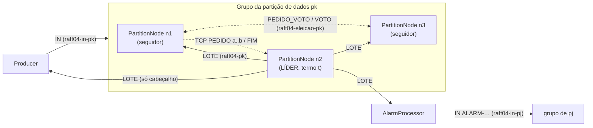

# COMINDIR05 · Eleição do Líder de Partição (ao estilo RAFT)

Relatório da ficha prática e guião para a apresentação oral. Ficha: <https://github.com/cunhaestgv/SD-2026-2027/issues/18> · Base: COMINDIR04 (heartbeat e envio em lote), em [../E1-COMINDIR04](../E1-COMINDIR04).

O guião passo a passo dos ensaios e as tabelas de medição estão em [ENSAIOS.md](ENSAIOS.md).

> Os valores medidos (tempos, contagens) só existem depois de executares os ensaios com o daemon IPFS real. Nas tabelas, os campos **[medir]** ficam por preencher. Nada neste relatório é um valor medido, exceto o que está explicitamente marcado como "validação com IPFS simulado".

---

## Índice

0. [Entregáveis, compilação, arranque e decisões](#0-entregáveis-compilação-arranque-e-decisões)
1. [a) Funcionamento](#a-funcionamento)
2. [b) O que resolve](#b-o-que-resolve)
3. [c) Diferenças entre a COMINDIR04 e a COMINDIR05](#c-diferenças-entre-a-comindir04-e-a-comindir05)
4. [d) Conceitos: CAP, partição de dados e de rede, divergência e truncagem](#d-conceitos)
5. [e) Tabela de falhas introduzidas](#e-tabela-de-falhas-introduzidas-passo-10)
6. [f) Reflexão crítica (passo 12)](#f-reflexão-crítica-passo-12)
7. [g) Limitações: o que o RAFT completo faria](#g-limitações-o-que-o-raft-completo-faria-e-aqui-não-está-feito)
8. [Anexo: respostas curtas às perguntas da ficha](#anexo-respostas-curtas-às-perguntas-da-ficha)

---

## 0. Entregáveis, compilação, arranque e decisões

### 0.1 Projetos (pacote `raft04`, tópicos `raft04-*`)

| Projeto | Classes | Classe principal |
|---|---|---|
| [raft04-no/](raft04-no/) | **`PartitionNode`**, **`RaftState`**, **`RaftCheck`**, `VoteRequest`, `VoteReply`, `CausalCheck`, `Batch`, `RecordFile` + partilhadas | `raft04.PartitionNode <k> <i> [N]` |
| [raft04-produtor/](raft04-produtor/) | `Producer`, `Batch`, `HeartbeatMonitor` + partilhadas | `raft04.Producer <N> [api]` |
| [raft04-processador/](raft04-processador/) | `AlarmProcessor`, `Batch`, `HeartbeatMonitor` + partilhadas | `raft04.AlarmProcessor <N> [api]` |

As classes partilhadas `Wire`, `Batch`, `SensorRecord`, `VectorClock`, `Partitioner` e `IpfsPubSub` são **iguais byte a byte** nos três projetos, e `HeartbeatMonitor` é igual no produtor e no processador. O `raft04-no` junta o `PartitionLeader` e a `PartitionReplica` da ficha anterior numa só classe, `PartitionNode`. Os scripts de ensaio estão em [scripts/](scripts/).

### 0.2 Compilar

```bash
# a partir de Sprints/E1-COMINDIR05 (Git Bash ou Linux)
scripts/compilar.sh
# equivalente, em cada um dos três projetos:
javac -encoding UTF-8 -d out src/raft04/*.java
```

### 0.3 Arrancar (todos na mesma máquina e na mesma pasta de trabalho)

Ordem: os 9 nós por qualquer ordem, depois o processador e por fim o produtor. Primeiro o daemon: `ipfs daemon --enable-pubsub-experiment`.

```bash
mkdir -p ensaios/teste && cd ensaios/teste
# nós (um terminal cada, ou todos em segundo plano com ../../scripts/nos.sh todos)
java -cp ../../raft04-no/out raft04.PartitionNode 0 1 3
java -cp ../../raft04-no/out raft04.PartitionNode 0 2 3
java -cp ../../raft04-no/out raft04.PartitionNode 0 3 3
java -cp ../../raft04-no/out raft04.PartitionNode 1 1 3
java -cp ../../raft04-no/out raft04.PartitionNode 1 2 3
java -cp ../../raft04-no/out raft04.PartitionNode 1 3 3
java -cp ../../raft04-no/out raft04.PartitionNode 2 1 3
java -cp ../../raft04-no/out raft04.PartitionNode 2 2 3
java -cp ../../raft04-no/out raft04.PartitionNode 2 3 3
# processador
java -cp ../../raft04-processador/out raft04.AlarmProcessor 3
# produtor
java -cp ../../raft04-produtor/out raft04.Producer 3
# no fim:
java -cp ../../raft04-no/out raft04.RaftCheck 3 . falhas.txt
java -cp ../../raft04-no/out raft04.CausalCheck 3 .
```

Opções (antes de `-cp`, iguais em todos os processos): `-Draft04.periodo=2000` (Δ), `-Draft04.eleicaoMin=6000`, `-Draft04.eleicaoMax=12000`, `-Draft04.fator=3`, `-Dfalha=1..5` (só nos nós), `-Draft04.api=http://127.0.0.1:5001/api/v0` (nós). Para os acentos aparecerem bem na consola do Windows, acrescenta `-Dstdout.encoding=UTF-8` (os scripts já o fazem).

### 0.4 Ficheiros produzidos (na pasta de trabalho)

| Ficheiro | Quem escreve | Conteúdo |
|---|---|---|
| `no-p<k>-n<i>.txt` | nó | `seq;termo;sensor;temperatura;instante;L;V` |
| `estado-p<k>-n<i>.txt` | nó (`RaftState`) | `termo;votouEm`, reescrito de forma atómica |
| `hb-p<k>-n<i>.txt` | nó, enquanto líder | `termo;hb;instante;ultimoSeq;ultimoTermo;n;bytes` |
| `eventos-p<k>-n<i>.txt` | nó | `instante;evento;p<k>;detalhe` |
| `truncados-p<k>-n<i>.txt` | nó (**acrescentado**) | `instante;<linha do registo descartado>` |
| `pid-p<k>-n<i>.txt` | nó (**acrescentado**) | PID do processo, para `falhar.sh` |
| `monitor-processador.txt`, `monitor-produtor.txt` | detetores | `instante;evento;p<k>;detalhe` |
| `produtor.txt` | produtor | `instante;p<k>;sensor;temperatura` |
| `falhas.txt`, `particoes.txt` | scripts | `p<k>;n<i>;instante` e `p<k>;n<i>;isolado|reparado;instante` |
| `relatorio-raft.txt`, `relatorio-causal.txt`, `vista-lamport.txt` | `RaftCheck`, `CausalCheck` | relatórios |

### 0.5 Pontos que a ficha deixa em aberto e decisões tomadas

| # | Em aberto | Decisão | Porquê |
|---|---|---|---|
| D1 | `rajada 300 10` dura menos de 1 s, mas 9(c) e 9(d) pedem uma falha de 30 s "durante" a rajada | `rajada <n> <s> [intervaloMs]`; sem o 3.º argumento comporta-se como antes. Nos ensaios: `rajada 300 10 200` (cerca de 60 s) | sem intervalo, a rajada acaba antes de a falha começar |
| D2 | o `RaftCheck` precisa do instante de arranque dos nós e do conteúdo dos registos truncados | evento **`ARRANQUE`** em `eventos-*` e ficheiro **`truncados-p<k>-n<i>.txt`** | o "tempo até ao primeiro líder" e o "existem com outro seq no líder" não se calculam sem isto |
| D3 | como introduzir as falhas do passo 10 | `-Dfalha=1..5`, por omissão desligado (como na COMINDIR04) | o código correto é o que corre por omissão; não há código "esquecido" por repor |
| D4 | porto de `nodePort(k, i)` | `7000 + 10k + i` (p0: 7001–7003, p1: 7011–7013, p2: 7021–7023) | sem colisões para G = 3 e N ≤ 10 |
| D5 | a falha 1 (`>= G/2`) não muda nada com G = 3 se a maioria só for verificada em `onVote` (o 1.º voto recebido já dá 2) | `tick()` também verifica a maioria logo após o voto em si próprio (como no RAFT). Com o código correto, 1 voto nunca é maioria | sem isto a falha 1 seria invisível |
| D6 | o líder da COMINDIR04 descartava o `IN` se `V[k] != seq` | o registo é escrito na mesma e é assinalado `ERRO` | assim a falha 5 chega aos ficheiros e o `CausalCheck` deteta-a; com o código correto nunca acontece |
| D7 | lacuna no lote: a COMINDIR02 retinha até `LIMITE_RETIDOS` | recuperação TCP imediata até `ultimoSeq` | os lotes trazem registos consecutivos; uma lacuna significa lotes perdidos, que não chegam depois |
| D8 | servidor TCP e `LOCK` | o servidor lê só do `RecordFile`, sem adquirir o `LOCK` do nó | um seguidor que recupera dentro do `LOCK` nunca espera pelo `LOCK` de outro nó (sem bloqueio mútuo entre nós) |
| D9 | líder isolado e `hb-*.txt` | não escreve a linha, porque o lote não foi publicado ("uma linha por lote **publicado**"); mostra `ISOLADO:` na consola | a liderança do nó isolado vê-se pelos eventos `LIDER`/`DEMISSAO` |
| D10 | `CausalCheck` lia `lider-p<k>.txt`, que já não existe | verifica `V[k]=seq` e L crescente em **cada** `no-*`; a análise entre partições usa o ficheiro do nó com maior (termo, seq) final | é assim que se mostra que `V[k]=seq` se mantém nas mudanças de líder |
| D11 | "leituras perdidas": como saber que uma linha de `produtor.txt` "consta" de um registo | emparelhamento por (sensor, temperatura) com o instante do registo em [envio − 1 s, envio + 15 s], cada registo usado uma vez | o `IN` não tem identificador; com todos os processos na mesma máquina os instantes são comparáveis |
| D12 | divergência só nas três condições da ficha | implementadas **só** as três condições (decisão tua) | ver a limitação L7 em g) |

---

## a) Funcionamento

### a.1 Arquitetura



- O **produtor** publica cada leitura `IN` em `raft04-in-p<k>`. Os três nós de p*k* recebem-na, mas **só o líder** lhe atribui `seq`; os outros assinalam `IGNORADO`. O produtor não precisa de saber quem é o líder.
- O **líder** acumula os registos em `pendentes` e publica a cada Δ = 2 s um `LOTE` em `raft04-p<k>`. O lote é ao mesmo tempo heartbeat e envio em lote, como na COMINDIR04, mas o cabeçalho passa a ter `termo`, `lider` e `ultimoTermo`.
- Os **seguidores** aplicam os lotes, recuperam lacunas por TCP e resolvem divergências por truncagem.
- O **processador** subscreve os lotes das três partições, ignora os de termo inferior ao maior já visto, deduplica por (`seq`, `termo`) e publica alarmes como `IN` noutra partição.
- O produtor e o processador mantêm um `HeartbeatMonitor` por partição, que passa a SUSPEITO quando a partição está sem líder conhecido.
- Cada partição de dados (p0, p1, p2) tem o seu grupo, o seu tópico de eleição e a sua sequência de termos. As eleições de partições diferentes são **independentes**.

### a.2 Papel de cada classe

| Classe | Papel |
|---|---|
| [RaftState](raft04-no/src/raft04/RaftState.java) | Estado e regras da eleição de **um** nó: termo e `votedFor` persistentes, papel, líder conhecido, votos, prazo aleatório. Métodos `tick`, `onVoteRequest`, `onVote`, `onBatch`, `termIfLeader`. Código dado no enunciado (+ comentários + `-Dfalha`). |
| [PartitionNode](raft04-no/src/raft04/PartitionNode.java) | O processo nó. Threads de entrada, dados, eleição, verificação, heartbeat e servidor TCP. Liga o `RaftState` ao registo: atribui `seq` como líder; aplica lotes, recupera e trunca como seguidor. |
| [VoteRequest](raft04-no/src/raft04/VoteRequest.java) / [VoteReply](raft04-no/src/raft04/VoteReply.java) | `PEDIDO_VOTO;termo;candidato;ultimoSeq;ultimoTermo` e `VOTO;termo;eleitor;candidato;S|N` |
| [Batch](raft04-no/src/raft04/Batch.java) | `LOTE;termo;lider;endereço;porto;hb;ultimoSeq;ultimoTermo;n` + n registos |
| [SensorRecord](raft04-no/src/raft04/SensorRecord.java) | Registo `seq;termo;sensor;temperatura;instante;L;V` (ganhou o `termo`) |
| [RecordFile](raft04-no/src/raft04/RecordFile.java) | Ficheiro `no-p<k>-n<i>.txt`: `append`, `all`, `range` e `rewrite` atómico (truncagem) |
| [Wire](raft04-no/src/raft04/Wire.java) | Constantes (Δ, prazos, G = 3), tópicos, `nodePort`, `isolated` (partição de rede simulada) |
| [HeartbeatMonitor](raft04-produtor/src/raft04/HeartbeatMonitor.java) | Detetor do produtor e do processador: `onHeartbeat(termo, líder, hb)` → `NOVO_LIDER`, `HB_PERDIDO`, `SUSPEITA`, `RETOMA` |
| [Producer](raft04-produtor/src/raft04/Producer.java) | Leituras manuais e rajadas; `produtor.txt`; `AVISO` se a partição estiver sem líder |
| [AlarmProcessor](raft04-processador/src/raft04/AlarmProcessor.java) | Filtro por termo máximo, deduplicação por (`seq`, `termo`), alarmes com `Lp`/`Vp` |
| [RaftCheck](raft04-no/src/raft04/RaftCheck.java) | Análise a posteriori: termos, votos, segurança, primeiro líder, lideranças simultâneas, indisponibilidade, perdidas, truncagens, coincidência, detetores |
| [CausalCheck](raft04-no/src/raft04/CausalCheck.java) | `V[k]=seq` e L crescente em cada nó; causalidade e Lamport entre partições |

### a.3 Estados de um nó

```mermaid
stateDiagram-v2
    [*] --> SEGUIDOR: arranque (termo e voto lidos de estado-*.txt)
    SEGUIDOR --> CANDIDATO: prazo de eleição expirou<br/>termo+1, vota em si, GRAVA, PEDIDO_VOTO
    CANDIDATO --> CANDIDATO: prazo expirou sem maioria<br/>(voto dividido) termo+1, novo sorteio
    CANDIDATO --> LIDER: VOTO S de uma maioria (2 de 3)<br/>inicializa seq, L, V; LOTE imediato
    CANDIDATO --> SEGUIDOR: LOTE do mesmo termo ou superior,<br/>ou mensagem de termo superior
    LIDER --> SEGUIDOR: mensagem de termo superior<br/>(DEMISSAO, TERMO)
    SEGUIDOR --> SEGUIDOR: LOTE válido / voto concedido<br/>(renova o prazo)
    LIDER --> [*]: falha (kill -9)
    SEGUIDOR --> [*]: falha
    CANDIDATO --> [*]: falha
```



- **Seguidor**: aplica os lotes do líder do termo atual e espera receber heartbeats. Cada `LOTE` válido e cada voto concedido sorteiam um novo prazo em [6 s, 12 s].
- **Candidato**: incrementou o termo, votou em si e pede votos. Fica líder com 2 votos; volta a seguidor se aparecer um líder do mesmo termo ou de um termo superior; se o prazo expirar sem maioria, começa outra eleição num termo superior.
- **Líder**: recebe os `IN`, atribui `seq` e publica um `LOTE` a cada Δ. Não tem prazo de eleição (`tick()` devolve −1). Só deixa de ser líder ao ver um termo superior, ou se falhar.

### a.4 Fluxo de uma eleição

```mermaid
sequenceDiagram
    participant N1 as n1 (seguidor)
    participant N2 as n2 (seguidor → candidato)
    participant N3 as n3 (seguidor)
    Note over N1,N3: termo 1, líder anterior falhou; nenhum LOTE desde t_hb
    Note over N2: prazo expira (6–12 s após o último LOTE)
    N2->>N2: tick(): termo=2, votedFor=n2, persist() → estado-p1-n2.txt
    N2->>N1: PEDIDO_VOTO;2;2;ultimoSeq;ultimoTermo
    N2->>N3: PEDIDO_VOTO;2;2;ultimoSeq;ultimoTermo
    N1->>N1: onVoteRequest: adota termo 2 (TERMO 1->2)<br/>termo igual? ainda não votou? registo de n2 >= o meu?<br/>sim → votedFor=n2, persist(), novo prazo
    N1->>N2: VOTO;2;1;2;S
    N3->>N3: idem (VOTO concedido ou recusado)
    N3->>N2: VOTO;2;3;2;S
    N2->>N2: onVote: votos={n2,n1} = maioria → LIDER<br/>becomeLeader(): seq, L, V do último registo, hb=0
    N2->>N1: LOTE;2;2;…;hb=1;ultimoSeq;ultimoTermo;n
    N2->>N3: LOTE;2;2;…;hb=1;…
    N1->>N1: onBatch(2, n2): NOVO_LIDER n2, novo prazo
    N3->>N3: onBatch(2, n2): NOVO_LIDER n2 (o 2.º VOTO, se chegar depois, é ignorado)
```

1. O seguidor cujo prazo expira primeiro chama `tick()`: incrementa o termo, vota em si, **grava** o estado e só depois publica o `PEDIDO_VOTO`, com o `seq` e o termo do seu último registo.
2. Cada eleitor adota o termo, se for superior. Concede o voto **se e só se** o termo do pedido é o seu, ainda não votou noutro nesse termo e o registo do candidato é pelo menos tão atualizado como o seu: o termo do último registo é maior, ou é igual e o `seq` é maior ou igual. Grava o voto antes de responder. Responde **sempre**, mesmo a recusar.
3. O candidato conta os votos (um `Set`, para não contar duas vezes o mesmo eleitor) e, com 2 de 3, passa a líder **dentro do mesmo `LOCK`** em que inicializa `seq`, L e V a partir do último registo e agenda o `LOTE` imediato.
4. O primeiro `LOTE` afirma a liderança: os outros nós reconhecem o líder (`NOVO_LIDER`) e renovam o prazo.

### a.5 O que acontece quando o líder falha

1. O líder morre (`kill -9`). Os registos que já tinham `seq` mas ainda estavam em `pendentes` ficam só no ficheiro dele.
2. Os seguidores deixam de receber `LOTE`. Entretanto, os `IN` enviados a p*k* chegam aos seguidores, que os assinalam `IGNORADO` e **perdem**. O produtor e o processador passam a SUSPEITO ao fim de 3Δ = 6 s e começam a escrever `AVISO`.
3. O primeiro seguidor a expirar (entre `t_hb + 6 s` e `t_hb + 12,2 s`) candidata-se. O outro seguidor vota nele, se o registo do candidato for pelo menos tão atualizado. Há maioria (2 de 3) e o candidato passa a líder num termo novo, continuando o `seq`, o L e o V a partir do seu último registo.
4. A indisponibilidade, desde a falha até ao primeiro `LOTE` do novo líder, fica em ]4 s; 12,2 s], com valor esperado de cerca de 7 s.
5. Quando o antigo líder volta, retoma o termo antigo do `estado-*.txt` como seguidor. Ao receber o primeiro `LOTE` do termo novo: `TERMO`, `NOVO_LIDER` e deteção de divergência (o seu `ultimoSeq` tem outro termo, ou tem registos para além do `ultimoSeq` do líder). Pede ao líder os registos a partir do início do seu último bloco de termo, trunca o que diverge (`TRUNCADO`) e aplica os do líder. Os registos pendentes que tinha perdem-se.

### a.6 Onde está cada coisa no código (CA2)

| Pergunta da avaliação | Onde |
|---|---|
| Onde se gravam o termo e o voto | [`RaftState.persist`](raft04-no/src/raft04/RaftState.java#L94), chamado em [`adoptTerm`](raft04-no/src/raft04/RaftState.java#L109), [`tick`](raft04-no/src/raft04/RaftState.java#L126) e [`onVoteRequest`](raft04-no/src/raft04/RaftState.java#L149) antes de o nó publicar |
| Condições de voto (termo, um voto, `upToDate`) | [`RaftState.onVoteRequest`](raft04-no/src/raft04/RaftState.java#L149-L170) |
| Condição de maioria | [`RaftState.hasMajority`](raft04-no/src/raft04/RaftState.java#L120) usada em [`onVote`](raft04-no/src/raft04/RaftState.java#L173) |
| Onde o nó se demite | [`RaftState.adoptTerm`](raft04-no/src/raft04/RaftState.java#L109) (`DEMISSAO`); a tarefa de heartbeat termina em [`enviarLote`](raft04-no/src/raft04/PartitionNode.java#L396) quando `termIfLeader()` deixa de ser o termo dela |
| Onde o novo líder inicializa `seq`, L e V | [`PartitionNode.becomeLeader`](raft04-no/src/raft04/PartitionNode.java#L311) |
| `IN` só com `termIfLeader()` dentro do `LOCK` | [`PartitionNode.onInput`](raft04-no/src/raft04/PartitionNode.java#L357) |
| Prazo de eleição e candidatura | [`PartitionNode.checkLoop`](raft04-no/src/raft04/PartitionNode.java#L253) → `tick()` |
| Aplicação dos lotes (duplicado, divergência, acrescento, lacuna) | [`PartitionNode.applyBatch`](raft04-no/src/raft04/PartitionNode.java#L474) |
| Resolução de divergência por blocos de termo e truncagem | [`resolveDivergence`](raft04-no/src/raft04/PartitionNode.java#L546), [`blockStart`](raft04-no/src/raft04/PartitionNode.java#L592), [`truncate`](raft04-no/src/raft04/PartitionNode.java#L600) |
| Partição de rede simulada | [`Wire.isolated`](raft04-no/src/raft04/Wire.java), consultado em `onData`, `onElection`, `publicarEleicao`, `enviarLote`, `fetch` e no servidor TCP |

### a.7 Secções sincronizadas e ordem dos locks

- **`LOCK` (monitor do nó)** protege o registo em memória e o ficheiro, `seq`, L, V, `hb` e `pendentes`. Todas as chamadas a `RaftState` que podem mudar o termo ou o papel (`tick`, `onVoteRequest`, `onVote`, `onBatch`) são feitas **dentro** de `LOCK`.
- **Ordem: `LOCK` → `RaftState`.** O `RaftState` nunca chama código do nó; só escreve eventos, por um terceiro lock `EVLOCK` que não chama nada. Nenhuma operação adquire os locks pela ordem inversa, por isso não há bloqueio mútuo. Se `RaftState` chamasse o nó (por exemplo, para ler `lastSeq`) enquanto outra thread tivesse `LOCK` e esperasse por `RaftState`, as duas threads bloqueavam-se para sempre.
- **Porque é que um `IN` não recebe o termo antigo depois da demissão:** `onInput` obtém `t = termIfLeader()` e atribui o `seq` na mesma secção `synchronized (LOCK)`. A demissão só acontece dentro de `onBatch`, `onVoteRequest` ou `onVote`, todas chamadas com `LOCK`. Ou o `IN` termina antes da demissão, com `t` ainda válido, ou começa depois e vê −1 (`IGNORADO`).
- **Publicar fora do lock:** `PEDIDO_VOTO`, `VOTO` e `LOTE` são publicados fora de `LOCK` (HTTP é lento). O estado de que dependem já foi gravado lá dentro.
- **Servidor TCP sem `LOCK`:** lê só do `RecordFile`, que é `synchronized` no próprio objeto. Um seguidor pode fazer a recuperação dentro de `LOCK` sem risco de bloqueio entre nós.

---

## b) O que resolve

| Problema na COMINDIR04 | Como fica na COMINDIR05 |
|---|---|
| **Ponto único de falha.** O líder era um processo fixo (`PartitionLeader`): se morresse, a partição ficava sem quem atribuísse `seq` até alguém o voltar a arrancar. "Detetar não é recuperar." | Qualquer dos três nós pode ser líder. Quando o líder falha, os sobreviventes elegem outro, sem intervenção humana. |
| **Disponibilidade.** As leituras enviadas durante a falha perdiam-se até ao reinício manual (minutos, ou para sempre). | Perdem-se **só durante a eleição** (]4 s; 12,2 s]). O sistema tolera a falha de 1 dos 3 nós de cada partição; com 2 falhas fica indisponível (falta maioria). |
| **Consistência das partições.** Se cada réplica, ao suspeitar, se fizesse líder sozinha, duas réplicas podiam atribuir o **mesmo** `seq` a leituras diferentes. | Só é líder quem tem a maioria, e cada nó vota no máximo uma vez por termo, de forma persistente. Duas maiorias de 3 intersetam-se, por isso há **no máximo um líder por termo**. Um líder obsoleto é reconhecido pelo termo inferior e ignorado. Quando há divergência, prevalece o registo do líder atual (truncagem). |
| **Arranque.** Ordem fixa (réplicas, líderes, processador, produtor) e líder configurado à mão. | A ordem entre nós é indiferente; a primeira eleição acontece no arranque. |

O que **não** resolve (ver g)): sem *commit* por maioria, a consistência continua a não ser forte. Um líder obsoleto aceita escritas que depois são descartadas, e um registo que o líder escreveu mas não chegou a publicar perde-se.

---

## c) Diferenças entre a COMINDIR04 e a COMINDIR05

### c.1 Tabela comparativa

| Aspeto | COMINDIR04 (heartbeat e lote) | COMINDIR05 (eleição) |
|---|---|---|
| Processos por partição | 1 líder fixo + 2 réplicas (atribuição da COMINDIR02) | 3 nós idênticos (`PartitionNode`), N × 3 = 9 processos |
| Quem é líder | `PartitionLeader <k>` por configuração | eleito por maioria; pode mudar a cada termo |
| Identificação da liderança | incarnação `inc` = instante do arranque, local ao líder | **termo**: inteiro crescente, persistente, partilhado pelo grupo |
| Reação à falha do líder | `SUSPEITA` e nada mais | eleição após um prazo aleatório em [6 s, 12 s] |
| Cabeçalho do `LOTE` | `LOTE;endereço;porto;inc;hb;ultimoSeq;n` | `LOTE;termo;lider;endereço;porto;hb;ultimoSeq;ultimoTermo;n` |
| Linha de registo | `seq;sensor;temp;instante;L;V` | `seq;termo;sensor;temp;instante;L;V` |
| Mensagens novas | — | `PEDIDO_VOTO`, `VOTO` no tópico `raft04-eleicao-p<k>` |
| Estado persistente | ficheiros de registos | + `estado-p<k>-n<i>.txt` (`termo;votouEm`), escrita atómica |
| Δ / verificação | 5000 ms / 1000 ms | 2000 ms / 200 ms |
| Recuperação TCP | só o líder serve, porto 7000+k | qualquer nó serve, porto 7000+10k+i |
| Duplicado num seguidor | `seq ≤ último` | mesmo `seq` **e** mesmo termo; mesmo `seq` com outro termo = **divergência** |
| Registos de um líder antigo | recuperados quando o mesmo líder volta | **truncados** se outro líder atribuiu esses `seq` |
| Processador | deduplica por `k#seq` | ignora lotes de termo < máximo e deduplica por `k#seq#termo` |
| Monitor (produtor/processador) | `REINICIO` quando `inc` muda | `NOVO_LIDER` quando o termo sobe; ignora termos inferiores |
| Produtor | só envia | + `produtor.txt` (uma linha por `IN`), rajada com intervalo opcional |
| Análise | `HeartbeatCheck` | `RaftCheck` (eleições e segurança) + `CausalCheck` adaptado |
| Simulação de partição de rede | — | ficheiro `isolar-p<k>-n<i>` (`Wire.isolated`) |
| Ordem de arranque | réplicas → líderes → processador → produtor | nós por qualquer ordem → processador → produtor |

### c.2 O que mudou no código

- **`PartitionLeader` + `PartitionReplica` → `PartitionNode`.** O código do líder (`onInput`, `enviarLote`, `pendentes`, `hb`) e o da réplica (aplicar lotes, recuperar por TCP) estão na mesma classe. Ativar cada papel depende do `RaftState`: `onInput` só atribui `seq` se `termIfLeader() != -1`, e `onData` só aplica se `onBatch()` devolver `true`.
- **`RaftState` (novo)** concentra as regras da eleição.
- **A inicialização do líder passou do arranque para `becomeLeader`.** Na COMINDIR04, `seq`, L e V eram lidos do ficheiro no `main`. Agora são lidos **cada vez que o nó ganha uma eleição**, a partir do último registo do **seu** ficheiro, que pode conter registos de outros líderes. `hb` volta a 0 em cada termo.
- **`enviarLote` termina a liderança:** se `termIfLeader()` não for o termo da tarefa, a tarefa agendada cancela-se.
- **Aplicação de lotes com termo:** o seguidor compara (`seq`, `termo`), deteta divergências em três situações e resolve-as com a procura por blocos de termo e a truncagem atómica (`RecordFile.rewrite`).
- **`HeartbeatMonitor.onHeartbeat(term, leader, hb)`** substitui `onHeartbeat(inc, hb)`.
- **`Wire`:** saem `inc` e `LIMITE_RETIDOS`; entram `ELEICAO_MIN_MS`, `ELEICAO_MAX_MS`, `GRUPO`, `topicElection`, `nodePort` e `isolated`.

### c.3 O que mudou no comportamento

- No arranque, durante os primeiros 6–12 s não há líder (na COMINDIR04 o líder existia logo).
- A falha do líder já não é permanente: a indisponibilidade passa de "até alguém reiniciar" para cerca de 7 s em média.
- O antigo líder, quando volta, **não** recupera a liderança e pode **perder** registos (truncagem). Na COMINDIR04, os registos pendentes do líder eram recuperados quando ele voltava.
- Pode haver **dois nós que se julgam líderes ao mesmo tempo** (termos diferentes) durante uma partição de rede. Na COMINDIR04 isso era impossível, porque havia um único líder.
- Uma falsa suspeita (pausa longa, rede lenta) passa a ter custo: provoca uma eleição e pode levar a truncagens.

---

## d) Conceitos

### d.1 Teorema CAP aplicado a este sistema

O teorema CAP (Brewer, 2000; Gilbert e Lynch, 2002) diz que, **durante uma partição de rede**, um serviço de dados replicado não pode garantir ao mesmo tempo:

- **C**, consistência: o sistema comporta-se como se houvesse uma única cópia; qualquer leitura vê a escrita concluída mais recente;
- **A**, disponibilidade: qualquer pedido a um nó que não falhou recebe uma resposta que não é um erro.

**P** (tolerar a perda de mensagens entre nós) não é opcional num sistema distribuído, por isso a escolha real é entre C e A quando a rede se divide.

Aplicado a esta ficha:

| Cenário | Lado maioritário (≥ 2 nós) | Lado minoritário (1 nó) | Interpretação |
|---|---|---|---|
| Falha do líder | elege novo líder e aceita escritas | — (nó morto) | não é uma partição de rede; durante a eleição, a partição está indisponível para escritas |
| Isolamento do líder | elege novo líder num termo superior e aceita escritas | o antigo líder **continua a aceitar escritas** no termo antigo até ver o termo novo | o RAFT pretende C; **sem commit, esta ficha não garante C**: o lado minoritário aceitou escritas que acabam descartadas |
| Isolamento de um seguidor | continua com o mesmo líder | o seguidor não consegue ser eleito (1 voto) e fica sem escrever | C: o lado minoritário fica indisponível para escritas |
| Falha de dois nós | — | o sobrevivente candidata-se em vão, termo após termo | C: sem maioria não há líder; a partição fica indisponível (perde A) |

Num RAFT completo, o lado minoritário fica **indisponível** e não aceita (nem confirma) escritas: o sistema é **CP**. Aqui, o antigo líder isolado aceita escritas que ninguém confirma. Quando a rede é reparada, o termo superior obriga-o a demitir-se e essas escritas são truncadas. Em rigor, esta implementação **não é CP** (ver f), CAP).

### d.2 Partição de dados vs partição de rede

| | Partição de **dados** (p0, p1, p2) | Partição de **rede** |
|---|---|---|
| O que é | divisão **deliberada** dos registos por sensor (`Partitioner`: `floorMod(hash, N)`) | **falha** de comunicação que divide os nós em conjuntos que não trocam mensagens |
| Para quê | distribuir a carga; cada partição tem o seu grupo, líder e termos | não é desejada; acontece |
| Duração | permanente (definida por N) | temporária (até ser reparada) |
| Nesta ficha | 3 grupos independentes; o termo de p1 nada tem a ver com o de p0 | simulada com `isolar-p<k>-n<i>`: o nó deixa de ouvir e de falar nos tópicos `raft04-p<k>` e `raft04-eleicao-p<k>` e no TCP, mas continua a receber os `IN` |
| A que se aplica o CAP | não se aplica | é **dela** que o CAP fala |

Uma partição de rede que isole n2 de p1 afeta só o grupo de p1. A partição de dados p1 continua a ser o mesmo conjunto de sensores (S02, S05, S08). A independência dos termos vem de cada grupo ter o seu tópico de eleição, o seu `estado-p<k>-n<i>.txt` e o seu `RaftState`: uma eleição em p1 nunca altera o termo de p0.

### d.3 Divergência e truncagem de registos

**Porque há divergência.** Sem *commit*, um líder escreve no seu ficheiro registos que os outros podem nunca receber: pendentes no momento da falha, ou atribuídos enquanto estava isolado. Entretanto, outro líder, num termo superior, atribui esses mesmos `seq` a outras leituras. Ficam dois registos com o mesmo `seq` e termos diferentes. Regra: o mesmo (`seq`, `termo`) é o mesmo registo, porque só há um líder por termo; termos diferentes significam que **prevalece o do líder atual**.

**Quando o seguidor a deteta** (`applyBatch`):

1. recebe um registo com um `seq` que já tem, mas com outro termo;
2. no fim do lote, o seu registo `ultimoSeq` tem termo diferente de `ultimoTermo`;
3. no fim do lote, tem registos para além de `ultimoSeq`.

**Como a resolve** (`resolveDivergence`):

1. Um **bloco de termo** é uma sequência máxima de registos consecutivos com o mesmo termo. Começa pelo primeiro `seq` do **último** bloco local, *s*.
2. Pede ao líder, por TCP, `PEDIDO s ultimoSeq`.
3. Se o primeiro registo recebido coincidir com o local (mesmo `seq` e termo), o prefixo até *s* é comum. Senão, recua um bloco (`s = início do bloco anterior`) e repete. Se chegar a `s = 1`, compara desde o início.
4. Percorre a partir de *s* até encontrar o primeiro `seq` *d* em que o registo local não existe no líder ou tem outro termo.
5. **Trunca** a partir de *d*: reescreve o ficheiro de forma atómica (temporário + `ATOMIC_MOVE`), guarda os descartados em `truncados-*` e assinala `TRUNCADO;p<k>;de=d;descartados=n;termos=[…]`.
6. Acrescenta os registos do líder a partir de *d*.

Exemplo da Figura 1: n2 volta com (1,1), (2,1), (3,1); o líder n3 tem (1,1), (2,1), (3,2). O lote diz `ultimoSeq=3 ultimoTermo=2`, mas o seq 3 local tem termo 1 (condição 2). O último bloco de n2 começa em 1 (tudo termo 1). `PEDIDO 1 3` → o primeiro coincide; a primeira diferença está em 3 → `TRUNCADO de=3 descartados=1 termos=[1]`. n2 aplica (3,2).

---

## e) Tabela de falhas introduzidas (passo 10)

Procedimento de cada falha em [ENSAIOS.md § III](ENSAIOS.md#iii-falhas-deliberadas-do-passo-10). Liga-se com `-Dfalha=<n>` nos nós.

**Tabela da ficha, a preencher com o que observares:**

| Falha introduzida | Lado onde surgiu | Detetada por `RaftCheck` / `CausalCheck`? | O que permitiu concluir |
|---|---|---|---|
| Maioria calculada como `votes.size() >= groupSize / 2` | [medir] | [medir] | [medir] |
| Termo e `votedFor` mantidos só em memória; um seguidor é reiniciado logo após conceder um voto, durante uma eleição | [medir] | [medir] | [medir] |
| Voto concedido sem a verificação `upToDate`, com o ensaio 9(a) repetido de modo a que o nó atrasado seja candidato | [medir] | [medir] | [medir] |
| Seguidor que aplica lotes de termo inferior ao seu, com o ensaio 9(d) repetido | [medir] | [medir] | [medir] |
| Novo líder que inicializa *L* e *V* a zero em vez de a partir do último registo | [medir] | [medir] | [medir] |

**O que esperar** (raciocínio + o que observei com o IPFS simulado; não são os teus resultados):

| Falha | Lado onde se manifesta | Quem deteta | O que se conclui |
|---|---|---|---|
| 1 · `>= G/2` | eleição: cada candidato elege-se sozinho; com prazo fixo, dois `LIDER` no **mesmo** termo | **RaftCheck** §1/§2 (`termos com mais de um LIDER` ≥ 1); evento `ERRO;dois lideres` em `onBatch` | a maioria tem de ser **estrita** (> G/2), para que duas maiorias se intersetem; 1 de 3 não interseta nada |
| 2 · estado em memória | nó reiniciado: volta com termo 0 e sem voto; pode votar duas vezes no mesmo termo | **RaftCheck** §2 (`diminuições do termo` > 0; `ARRANQUE termo=0` depois de termos maiores); com azar, dois líderes num termo | a garantia "um voto por termo" só vale entre falhas se o voto for gravado **antes** de ser publicado |
| 3 · sem `upToDate` | eleição: ganha um nó com o registo atrasado; os outros truncam registos que tinham | **RaftCheck** §7 (truncagens sem ter havido líder isolado) e §6 (perdidas por truncagem); §1 mostra o líder com votos de nós mais atualizados. O `CausalCheck` não vê nada (os registos que ficam são coerentes) | a restrição de voto protege os registos que uma maioria já tem |
| 4 · aplica termo inferior | seguidores: aplicam lotes do líder obsoleto depois de conhecerem o termo novo, e chegam a truncar registos bons | **RaftCheck** §2 (`termo … diminuiu (RECEBIDO)`), §7 (truncagens a mais) | o termo só serve se as mensagens de termo inferior forem **rejeitadas** |
| 5 · L e V a zero | novo líder: o primeiro registo do termo novo tem `V[k]=1 != seq` e `L` mais pequeno que o anterior | **CausalCheck** §1 (`V[k]!=seq`, `L não crescente`); evento `ERRO;V[k]=… != seq` | o novo líder tem de **continuar** a história causal do anterior |

---

## f) Reflexão crítica (passo 12)

Os valores entre **[medir: …]** vêm dos teus ensaios (tabelas em [ENSAIOS.md § IV](ENSAIOS.md#iv-tabelas-do-passo-11-preencher-com-valores-medidos)).

### f.1 Eleição no arranque

Com base em 9(b): **[medir: termos até ao 1.º líder e votos divididos, aleatório vs fixo]**.

- **Porque é que os prazos aleatórios evitam votos divididos.** Com prazos sorteados em [6 s, 12 s], é raro dois nós expirarem com uma diferença menor do que o tempo de uma votação (alguns ms a dezenas de ms: publicar `PEDIDO_VOTO` e receber um `VOTO`). O primeiro a expirar pede os votos, recebe-os e publica o `LOTE` antes de o segundo expirar, e o `LOTE` renova o prazo do segundo. Com prazo fixo e arranque simultâneo, os três expiram quase juntos, votam em si próprios e recusam os outros: voto dividido. Como cada voto concedido e cada candidatura voltam a usar o **mesmo** prazo, tendem a empatar outra vez no termo seguinte. Com prazo fixo, só sai um líder quando as diferenças de arranque e de atraso da JVM desempatam.
- **Porque é que a ordem de arranque deixou de importar.** Não há líder configurado: ninguém espera por ninguém. Os primeiros nós a arrancar ficam seguidores e, se expirarem antes de haver maioria viva, candidatam-se em vão e tentam outra vez num termo superior. Assim que há 2 nós, a eleição pode ter sucesso. Os `IN` e os `LOTE` não dependem da ordem, e a recuperação TCP serve-se em qualquer nó.
- **Relação entre Δ, `ELEICAO_MIN_MS` e `ELEICAO_MAX_MS`.** Deve ser `tempo de difusão ≪ Δ < ELEICAO_MIN_MS < ELEICAO_MAX_MS ≪ tempo médio entre falhas`. `ELEICAO_MIN_MS` tem de ser **vários Δ** (aqui 3Δ), para que um líder vivo renove o prazo dos seguidores várias vezes antes de expirar, mesmo com um ou dois lotes perdidos ou atrasados. `ELEICAO_MAX_MS − ELEICAO_MIN_MS` tem de ser largo face ao tempo de uma votação (aqui 6 s), para tornar o empate improvável. Ao mesmo tempo, `ELEICAO_MAX_MS` limita a indisponibilidade (]4 s; 12,2 s]).
- **Se `ELEICAO_MIN_MS < Δ`**, um seguidor pode expirar **entre dois lotes de um líder saudável**. Ver-se-iam candidaturas constantes, termos a subir sem parar, líderes saudáveis a demitir-se (`DEMISSAO`) e lotes de termo antigo a ser ignorados. A partição passaria grande parte do tempo sem líder. Seria um falso positivo permanente do "detetor".

### f.2 O termo

**Demonstração (no máximo um líder por termo).** Suponha-se que *A* e *B* (*A* ≠ *B*) são ambos líderes no termo *t*.

1. *A* teve votos `S` de um conjunto *Q_A* de nós com |*Q_A*| ≥ ⌊3/2⌋ + 1 = 2, todos dados **no termo *t*** (`onVote` exige `vTerm == term`). O mesmo vale para *B*, com *Q_B*.
2. |*Q_A*| + |*Q_B*| ≥ 4 > 3 = G, logo *Q_A* ∩ *Q_B* ≠ ∅: há um nó *X* que votou em *A* e em *B* no termo *t*.
3. Mas *X* só concede se `votedFor == 0 || votedFor == candidato`, e grava `votedFor = candidato` antes de responder. `votedFor` só volta a 0 em `adoptTerm`, ou seja, num termo **superior**. Por isso, no termo *t*, *X* votou num único candidato. Contradição.
4. A persistência garante que isto se mantém mesmo que *X* falhe e volte a arrancar. Um candidato vota em si próprio (`tick`), por isso também não pode votar noutro nesse termo.

**Porque é que isso não impede dois líderes ao mesmo tempo (9(d)).** A garantia é "um por **termo**", não "um em cada **instante**". O antigo líder isolado continua no termo *t* e não sabe que a maioria elegeu outro no termo *t* + 1. Durante o isolamento, os dois julgam-se líderes, em termos diferentes. Medido em 9(d): **[medir: nós, termos e duração da liderança simultânea]**.

**Papel do termo quando a partição é reparada.** É o desempate: a primeira mensagem do termo *t* + 1 que chega ao antigo líder obriga-o a demitir-se (`adoptTerm`). Qualquer mensagem dele com termo *t* passa a ser ignorada pelos outros (`onBatch` devolve `false`) e pelo processador (filtro de termo máximo). O termo dos registos (`seq;termo;…`) permite depois detetar e truncar o que ele escreveu no termo antigo.

**Termo vs relógio de Lamport (COMINDIR03):**

| | Termo | Relógio de Lamport |
|---|---|---|
| Semelhanças | inteiro, só cresce, viaja em todas as mensagens, regra do máximo: quem recebe um valor superior adota-o | idem |
| Quando incrementa | só quando um nó se candidata | em cada evento (aqui, cada atribuição de `seq`) |
| O que ordena | épocas de liderança, não eventos | eventos (condição de relógio *a* → *b* ⇒ L(*a*) < L(*b*)) |
| Mensagem com valor inferior | **rejeitada** (vem de um líder/candidato obsoleto) | aceite: só não faz o relógio andar para trás |
| Efeito colateral | adotar um termo superior demite líderes e candidatos | nenhum |
| Persistência | obrigatória (`estado-*.txt`) | o líder retomava L do último registo |

### f.3 CAP e particionamento

Classificação com base na segunda tabela do passo 11 (**[medir: preencher a tabela]**). Pelo raciocínio de d.1: falha do líder → C (indisponível durante a eleição); isolamento do líder → **nem C nem A puros** (o lado minoritário aceitou escritas, logo não é C, e depois descartou-as); isolamento de um seguidor → C (a minoria fica indisponível); falha de dois nós → C (a partição inteira fica indisponível).

- **Porque é que o lado minoritário não consegue eleger líder.** Precisa de 2 votos; do seu lado só existe ele. Os `PEDIDO_VOTO` não chegam ao outro lado (`isolated`), por isso fica com 1 voto, termo após termo.
- **O sistema desta ficha é, em rigor, CP?** **Não.** O antigo líder isolado aceitou escritas (atribuiu `seq`, escreveu-as no ficheiro). Quem lesse o ficheiro dele veria dados que depois desapareceram (truncagem). Isso viola C ("cada leitura vê a última escrita concluída"), e as escritas também não foram "disponibilizadas" de forma útil, porque se perderam. O sistema só garante que a **história final** do grupo é a do lado maioritário.
- **Mecanismo que o tornaria CP: *commit* por maioria** (`AppendEntries` com resposta e índice de *commit*). O líder só considera um registo aceite (e só o aplica e responde ao cliente) depois de uma maioria o ter gravado. O líder isolado nunca obteria maioria, por isso nenhuma escrita sua seria confirmada; o lado minoritário ficaria **indisponível para escritas** (CP). Para leituras linearizáveis, juntar *ReadIndex* ou *leader leases*.
- **Custo:** cada escrita passa a esperar pela ida e volta a uma maioria (pelo menos 1 RTT + gravação em disco no seguidor), o que aumenta a latência e baixa o débito. Na minoria, e com 2 nós em baixo, as escritas são recusadas ou ficam à espera: perde-se A. Os lotes deixariam de ser "dispara e esquece" e o produtor precisaria de confirmação.

### f.4 Restrição de voto e truncagem

Com base em 9(a) e na falha 3: **[medir: registos truncados em 9(a); o que aconteceu com `-Dfalha=3`]**.

- **O que protege.** Um nó só é eleito se o seu último registo for pelo menos tão atualizado como o de cada um dos que votaram nele. Como precisa de uma maioria, o novo líder tem **todos os registos que uma maioria já tinha**. Esses registos nunca são truncados pela eleição. Com `-Dfalha=3`, um nó vazio ganha e os outros truncam registos que todos os não isolados tinham.
- **O que não protege.** Os registos que **só** uma minoria tem: os `pendentes` de um líder que falha antes de publicar (Figura 1, `S02 20.4`), e as escritas de um líder isolado (9(d)). Também não protege as leituras enviadas sem líder, que nunca chegam a ser registos.
- **Porque é que, sem *commit*, uma leitura escrita no ficheiro do líder se pode perder.** Escrever no ficheiro do líder não quer dizer que a leitura está replicada. Se o líder falhar antes de o lote chegar a uma maioria, o novo líder (eleito por quem não tem o registo) atribui esse `seq` a outra leitura, e a do antigo líder é truncada quando ele volta. A restrição de voto compara registos **existentes**; não pode proteger o que nunca chegou à maioria. Com *commit*, o líder só daria a escrita por aceite depois de uma maioria a ter, e aí a restrição de voto garantiria que nenhum líder futuro a perdia.

### f.5 Persistência

Com base na falha 2: **[medir: o que o RaftCheck mostrou com `-Dfalha=2`]**.

- **Porque é que o termo e o voto têm de ser persistentes.** Se o voto ficar só em memória, um nó que votou em *A* no termo *t*, falha e volta a arrancar esquece-se e pode votar em *B* no mesmo termo. *A* e *B* ficam ambos com maioria e há dois líderes no termo *t*, o que quebra a demonstração de f.2. Se o termo ficar só em memória, o nó volta ao termo 0: pode aceitar lotes de líderes obsoletos e responder a pedidos antigos como se fossem atuais. E tem de ser gravado **antes** de publicar: se o `VOTO` saísse e o nó falhasse antes de gravar, o efeito seria o mesmo.
- **Porque é que os registos também são persistentes.** São a cópia de dados da partição: são eles que permitem a qualquer nó ser o próximo líder sem perder a história. Além disso, a restrição de voto usa `ultimoSeq` e `ultimoTermo`. Um nó que perdesse o registo e mantivesse o termo podia votar num candidato atrasado, ou dar a um candidato a impressão errada de estar atualizado.
- **O mecanismo da ficha anterior que tinha um papel semelhante ao termo** era a **incarnação `inc`** (instante do arranque do líder), mais o `seq` persistente no ficheiro do líder. A `inc` identificava a "época" do líder fixo e deixava os participantes detetar um reinício (`REINICIO`) e ignorar heartbeats de uma incarnação anterior. As diferenças: era local a um processo, não resultava de acordo nenhum e não era gravada (cada arranque gerava uma nova).

### f.6 Detetar, suspeitar e eleger

Com base em 9(d): **[medir: efeito do isolamento do líder e do regresso do seguidor]**.

- **Custo de uma falsa suspeita.** Na COMINDIR04 uma suspeita só gerava um evento. Agora uma pausa longa do líder (GC, máquina sobrecarregada, `kill -STOP`) maior do que o prazo provoca uma eleição. A partição fica 4–12 s sem aceitar escritas (leituras perdidas), elege-se outro líder e, quando o antigo retoma, ainda pode atribuir `seq` no termo antigo até ver o novo. Esses registos são truncados. Uma falsa suspeita passa a custar disponibilidade e dados.
- **Porque é que o seguidor isolado provoca uma eleição desnecessária.** Isolado, o seu prazo expira a cada 6–12 s e ele incrementa o termo (em 9(d), com 60 s, sobe vários termos). Quando volta, o seu `PEDIDO_VOTO` leva um termo superior ao do líder saudável. Pela regra do termo, o líder **adota-o e demite-se**, mesmo que o pedido seja recusado (o registo do isolado está atrasado). Segue-se uma eleição sem necessidade nenhuma: nada falhou.
- **Pre-Vote (excluído da ficha).** Antes de incrementar o termo, o candidato faz uma "pré-votação": pergunta se os outros votariam nele **no termo *t* + 1**, sem alterar nada. Os outros recusam se o registo dele estiver atrasado ou se ouviram o líder há pouco (menos de `ELEICAO_MIN_MS`). Só com maioria na pré-votação incrementa o termo e faz a eleição real. Um nó isolado nunca passa da pré-votação, por isso o seu termo não sobe e o regresso não perturba o líder.

### f.7 Limites

Com base em 9(c) e 9(e): **[medir: leituras perdidas na indisponibilidade de 9(c) e nos 30 s de 9(e)]**.

- **O que acontece às leituras enviadas a uma partição sem líder.** Os nós vivos recebem-nas no tópico `raft04-in-p<k>`, mas nenhum é líder: assinalam `IGNORADO` e descartam-nas. O produtor escreve um `AVISO` mas envia na mesma, e não guarda nem reenvia. Perdem-se sem deixar rasto no registo da partição. Em 9(e), com 2 nós em baixo, perdem-se **todas** até haver maioria outra vez.
- **O que seria preciso para que nenhuma leitura aceite fosse perdida, sem duplicados:**
  1. *commit* por maioria: o líder só confirma ao produtor depois de uma maioria ter o registo;
  2. o produtor dá a cada leitura um **identificador único** (id do produtor + número de sequência local) e **guarda-a até receber a confirmação**, reenviando-a (para o novo líder) se não a receber;
  3. o líder **deduplica** pelo identificador. O conjunto de identificadores já aplicados faz parte do estado replicado (vai no registo), para que um novo líder também reconheça um reenvio de algo que o anterior já confirmou. Isto dá entrega exatamente uma vez *efetiva*: pelo menos uma vez por causa do reenvio, idempotente por causa da deduplicação.
- **Cabe no âmbito desta ficha?** **Não.** A ficha exclui explicitamente o *commit* por maioria e a retenção ou reenvio de leituras pelo produtor. A conclusão é que **esta solução não resolve esse problema**.

---

## g) Limitações: o que o RAFT completo faria (e aqui não está feito)

| # | Limitação nesta ficha | O que o RAFT completo faz |
|---|---|---|
| L1 | **Sem *commit* por maioria.** Um registo escrito no ficheiro do líder não está garantido; o líder isolado aceita escritas que depois são truncadas. | `AppendEntries` com resposta; `commitIndex` avança quando uma maioria tem o registo; só os registos *committed* são aplicados e confirmados ao cliente. |
| L2 | **Sem retransmissão pelo líder.** O líder publica cada registo uma vez; quem perde o lote pede por TCP. | O líder mantém `nextIndex`/`matchIndex` por seguidor e reenvia até cada um confirmar. |
| L3 | **Sem verificação de consistência em cada envio.** Só se verificam o último registo (`ultimoSeq`/`ultimoTermo`) e os `seq` repetidos. | Cada `AppendEntries` leva `prevLogIndex`/`prevLogTerm`; o seguidor recusa se o registo anterior não coincidir (*Log Matching Property*). |
| L4 | **Sem Pre-Vote.** Um nó isolado faz subir o termo e, quando volta, depõe um líder saudável. | Pré-votação (extensão PreVote) e, em algumas implementações, *CheckQuorum*: o líder demite-se se deixar de ouvir uma maioria (o que também limitaria o tempo do líder isolado a aceitar escritas). |
| L5 | **Sem *leader leases* nem *ReadIndex*.** Ler o ficheiro de um nó (mesmo do líder) pode dar dados obsoletos ou dados que vão ser truncados. | Leituras linearizáveis: o líder confirma com uma maioria que ainda é líder (*ReadIndex*) ou usa um arrendamento temporal (*lease*). |
| L6 | **Leituras perdidas durante a eleição** e sem reenvio pelo produtor. | Os clientes reenviam com identificador único; a máquina de estados deduplica (sessões de cliente). |
| L7 | **Divergência não detetada num caso.** Um antigo líder com poucos registos obsoletos que recebe lotes com `seq` **superiores** aos seus recupera a lacuna por TCP e acrescenta os registos novos depois dos obsoletos. Nenhuma das três condições dispara e a divergência fica no prefixo. Nos ensaios da ficha (Figura 1, 9(d) com rajada) as condições chegam, porque o antigo líder tem `seq` iguais ou superiores aos do lote; o `RaftCheck` §8 deteta-o se acontecer. | `prevLogTerm` (L3) recusaria logo o primeiro registo novo. |
| L8 | **Sem compactação nem *snapshots*.** O ficheiro cresce sem limite; a resolução de divergência relê e reenvia blocos inteiros. | *Snapshots* + `InstallSnapshot` para seguidores muito atrasados. |
| L9 | **Grupo fixo** (G = 3, n1..n3). | Alteração de membros (*joint consensus* ou um servidor de cada vez). |
| L10 | **Persistência sem `fsync`.** A gravação atómica (temporário + `ATOMIC_MOVE`) garante que não há ficheiro meio escrito, mas não que o conteúdo já está no disco se faltar a energia. | Forçar a escrita (`FileChannel.force`/`fsync`) antes de responder. |
| L11 | **Recuperação por TCP com o `LOCK` do nó.** Durante uma recuperação lenta, o nó não responde a votos nem trata `IN`. | Implementações reais separam a replicação da máquina de estados e usam E/S assíncrona. |
| L12 | **"Partição de rede" simulada por ficheiro**, verificada por mensagem; o daemon IPFS continua a entregar tudo. | Numa rede real, as perdas são parciais e assimétricas, com atrasos variáveis. |

---

## Anexo: respostas curtas às perguntas da ficha

### Diagnóstico inicial (2.2)

- **(a)** Com 2 cópias, a maioria é 2: **não tolera nenhuma** falha. Com 3, a maioria é 2: tolera **1**. Com 4, a maioria é 3: continua a tolerar só **1**, e há mais nós para falhar e mensagens a trocar. Por isso usam-se grupos de tamanho ímpar (2*f* + 1 tolera *f*).
- **(b)** Cada nó dá um voto por termo e duas maiorias de 3 têm um nó em comum, que teria votado duas vezes (ver f.2). **Sim**, podem existir dois nós que se julgam líderes ao mesmo tempo, em termos **diferentes** (9(d)).
- **(c)** Sem eleição, o líder isolado continuava a ser o único a atribuir `seq`, os seguidores não recebiam nada e ninguém o substituía. Com eleição por maioria, só o lado dos 2 seguidores pode eleger um líder novo. O isolado continua a julgar-se líder do termo antigo, mas não pode ser **eleito** em termo nenhum. A partição de rede e a partição de dados p1 são coisas diferentes: a de rede afeta a comunicação entre os 3 nós que servem os dados de p1.

### "Antes de avançar" (passos 1, 3, 4, 6)

- **`adoptTerm` repõe `votedFor = 0`** porque o voto é por termo; sem isso, o nó ficava preso ao voto do termo anterior e recusava todos os candidatos do novo termo (eleição bloqueada).
- **Conceder outra vez ao mesmo candidato:** o PubSub pode entregar o mesmo `PEDIDO_VOTO` duas vezes, ou o candidato pode repeti-lo; voltar a concedê-lo é seguro, porque é o mesmo voto, e evita perder a eleição por uma resposta que não chegou.
- **`ERRO` em `onBatch`:** um nó líder no termo *t* recebe um `LOTE` de outro líder no **mesmo** termo, o que significaria dois líderes em *t*. Impossível pelas regras de voto e maioria; com `-Dfalha=1` acontece.
- **Ficheiro temporário + `ATOMIC_MOVE`:** quem lê vê sempre o ficheiro antigo ou o novo, nunca meio escrito. Continua a faltar o `fsync`: depois de uma falha de energia, o conteúdo pode não estar no disco.
- **Falha entre a gravação e o `PEDIDO_VOTO`:** no arranque, o nó retoma o termo *t* com `votedFor` = ele próprio. Não vota noutro em *t*; o próximo prazo leva-o a *t* + 1. Perdeu-se um termo, sem consequências.
- **Responder mesmo a recusar:** o `VOTO` leva o termo do eleitor; se for superior, o candidato atrasado adota-o e desiste (`onVote` → `adoptTerm`), em vez de continuar a candidatar-se num termo inútil.
- **Primeiro `LOTE` no arranque (termo 0, sem líder):** o primeiro prazo a expirar fica em [6 s; 12 s] (+ até 200 ms de verificação), mais o tempo da votação (ms). Mínimo ≈ 6 s, máximo ≈ 12,2 s.
- **Ordem dos locks:** sempre `LOCK` → `RaftState`; nenhuma operação faz o inverso (`RaftState` não chama o nó). Se fizesse, uma thread com `LOCK` à espera de `RaftState` e outra com `RaftState` à espera de `LOCK` bloqueavam-se mutuamente.
- **L e V a partir do último registo:** para que `V[k] = seq` e L estritamente crescente continuem verdadeiros através das mudanças de líder. Começar em zero faz falhar a verificação 1 do `CausalCheck` (`V[k]!=seq` e `L não crescente`), como na falha 5.
- **`IN` recebido pelo líder do termo 1 e não publicado:** o líder do termo 2 também recebeu esse `IN` (todos os nós subscrevem o tópico de entrada). Se já era líder nesse instante, atribui-lhe outro `seq`; se ainda estava em eleição, ignorou-o. A cópia do termo 1 é truncada quando o antigo líder volta: ou a leitura existe com outro `seq`, ou perdeu-se.
- **Processador recebe (7, termo 3) depois de (7, termo 2):** são registos **diferentes** (o 2 foi substituído). Trata-o e, se a temperatura justificar, **gera outra vez o alarme**. Consequência: um alarme pode ser gerado a partir de um registo que depois foi descartado, e a contagem de alarmes pode exceder a de registos finais acima do limiar. O processador não "desfaz" alarmes.

### Perguntas de verificação (CA1 a CA4), resumo

- **CA1, n1 falha em *t* = 15 (Figura 1):** só sobra n3, que tem 1 voto e não é maioria. n3 **não** pode ser eleito no termo 2; p1 fica sem líder até n1 ou n2 voltarem: perde **A** para manter **C**.
- **CA1, porque é que n2 não volta a ser líder:** quando regressa, n3 já é líder do termo 2. n2 recebe o `LOTE` do termo 2 e passa a seguidor. Ter registos até ao seq 3 não conta: o seq 3 dele é do termo 1, e o (3, termo 2) de n3 é mais atualizado. **Se regressasse em *t* = 16**, antes de qualquer eleição, com o último registo (3, 1): seria **mais** atualizado do que n1 e n3, que têm (2, 1). Se fosse o primeiro a expirar, os outros votariam nele e podia ser eleito no termo 2 (o seq 3 sobreviveria).
- **CA2:** ver a.6 e a.7.
- **CA3:** usar `relatorio-raft.txt` §1 a §8 e `relatorio-causal.txt` §1 de cada ensaio. Um voto dividido nos `eventos-*` são dois ou mais `CANDIDATO` com o mesmo termo, `VOTO … recusado` e nenhum `LIDER` nesse termo.
- **CA4:** ver f.4 a f.7 e g): *commit* por maioria (CP, à custa de disponibilidade e latência), Pre-Vote, reenvio idempotente pelo produtor.
